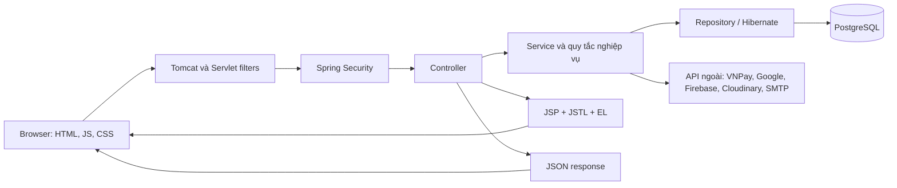
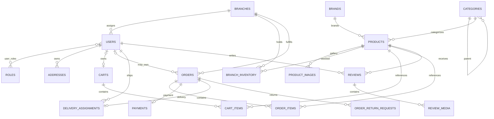
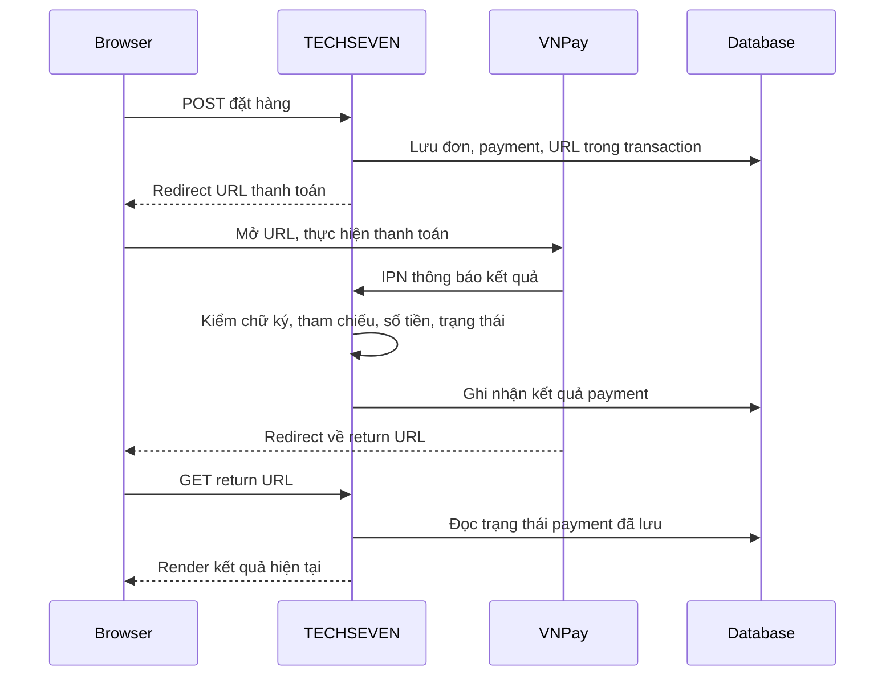
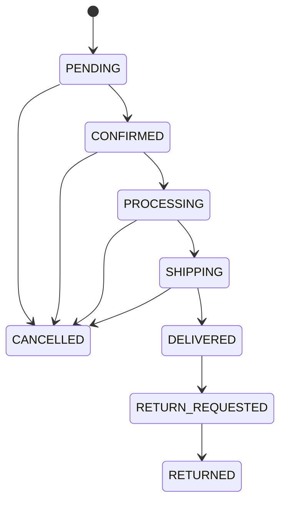

# TECHSEVEN — Tài liệu học toàn bộ công nghệ và kiến thức trong project

> Tài liệu được đối chiếu với source tại `D:/Semester_5/Project/WebProject`, ngày 27/10/2026. Đây là tài liệu giải thích code hiện có, không phải danh sách tính năng dự kiến.
>
> Snapshot: 178 file Java chính, 23 entity JPA, 35 trang JSP, 21 file test Java. Bao gồm bản sửa hủy đơn `PENDING` vừa kiểm thử nhưng chưa commit tại thời điểm viết. File này không chứa giá trị secret, mật khẩu hay service account.

## Mục lục

1. [Project giải quyết bài toán gì?](#overview)
2. [Bản đồ công nghệ](#technology)
3. [Kiến trúc và một request đi qua hệ thống](#architecture)
4. [Java nền tảng và cấu trúc dữ liệu](#java)
5. [Spring Boot, IoC, DI, Bean và cấu hình](#spring)
6. [HTTP, MVC, API, DTO và validation](#http)
7. [JSP, JSTL, EL và frontend](#frontend)
8. [PostgreSQL, JPA, Hibernate và mô hình dữ liệu](#database)
9. [Transaction, concurrency và khóa database](#transactions)
10. [Bảo mật: JWT, BCrypt, CSRF và phân quyền](#security)
11. [Đăng ký, OTP email, Google, điện thoại và hồ sơ](#authentication)
12. [Sản phẩm, danh mục, bộ lọc và phân trang](#catalog)
13. [Giỏ hàng và quy tắc giá bán](#cart)
14. [Checkout và khách vãng lai](#checkout)
15. [Thanh toán COD và VNPay](#payments)
16. [Kho, trạng thái đơn, phân công và giao hàng](#orders)
17. [Trả hàng, khuyến mãi, audit và thống kê](#management)
18. [Review, upload và Cloudinary](#media)
19. [Google Maps và tính phí giao hàng](#maps)
20. [Gemini: tìm sản phẩm bằng ngôn ngữ tự nhiên](#gemini)
21. [WebSocket, STOMP, event và polling](#realtime)
22. [Maven, Docker, Vercel, Render và GitHub Actions](#deployment)
23. [Testing và cách đọc test](#testing)
24. [Các ranh giới và phần chưa hoàn thiện](#boundaries)
25. [Lộ trình học, bài thực hành và câu hỏi bảo vệ](#learning)
26. [Từ điển thuật ngữ](#glossary)
27. [Phụ lục: endpoint, bảng dữ liệu, toàn bộ class và test](#appendices)

<a id="overview"></a>
## 1. Project giải quyết bài toán gì?

TECHSEVEN là website bán thiết bị điện máy theo mô hình nhiều chi nhánh. Người mua tìm sản phẩm, xem tồn kho, đặt hàng, thanh toán và theo dõi giao hàng. Nhân viên xử lý đơn/kho theo chi nhánh; admin quản lý toàn hệ thống; shipper xử lý những đơn được phân công.

### 1.1. Các vai trò nghiệp vụ

| Vai trò | Danh tính trong code | Công việc chính |
|---|---|---|
| Khách vãng lai | Chưa có `Principal`, có thể có `HttpSession` | Xem sản phẩm, dùng giỏ khách, đặt đơn và xem đơn bằng quyền cấp cho session |
| Khách hàng | `ROLE_CUSTOMER` | Quản lý hồ sơ, lịch sử đơn, yêu cầu trả hàng, đánh giá khi đủ điều kiện |
| Nhân viên chi nhánh | `ROLE_STAFF` và `User.branch` | Quản lý đơn, tồn kho, phân công và trả hàng trong chi nhánh được gán |
| Quản trị viên | `ROLE_ADMIN` | Quản lý người dùng, vai trò, sản phẩm, danh mục, chi nhánh và dữ liệu quản trị |
| Shipper | `ROLE_SHIPPER` và chi nhánh | Nhận danh sách được phân công, cập nhật giao hàng, xem thống kê cá nhân |

Vai trò được kiểm tra cả ở URL và trong nhiều service. Một tài khoản là nhân viên chưa có nghĩa được thao tác đơn của mọi chi nhánh.

### 1.2. Các miền nghiệp vụ

```text
Identity:     tài khoản, vai trò, OTP, Google, điện thoại
Catalog:      sản phẩm, ảnh, thương hiệu, cây danh mục
Shopping:     giỏ hàng, checkout, giá bán, voucher, phí ship
Fulfillment:  chi nhánh, kho, đơn, shipper, trạng thái giao
Payment:      COD, VNPay, IPN, trạng thái thanh toán
After-sales:  review, media, yêu cầu trả hàng
Management:   phân quyền, audit, điều chỉnh kho, thống kê
Integration:  Google Maps, Gemini, Firebase, Gmail, Cloudinary
```

<a id="technology"></a>
## 2. Bản đồ công nghệ

Phiên bản ở đây lấy từ file cấu hình/source, không khẳng định đó là phiên bản mới nhất ngoài thị trường.

Nguồn khai báo dependency: [pom.xml](D:/Semester_5/Project/WebProject/pom.xml).

| Công nghệ/thư viện | Project dùng để làm gì? | Nơi đọc cách sử dụng |
|---|---|---|
| Java 21 | Ngôn ngữ backend, xử lý nghiệp vụ và concurrency | Các class trong phụ lục; `java.version` trong POM |
| Spring Boot 4.1.1 | Khởi động ứng dụng và tự cấu hình các thành phần | `DienmayShopApplication`, cấu hình properties |
| Spring Web MVC | Điều phối HTTP, render JSP, cung cấp API JSON | Các controller |
| Servlet, embedded Tomcat, Jasper | HTTP runtime; JSP được dịch thành servlet | `ServletInitializer`, `PrecompiledJspConfiguration`, POM |
| JSP + Jakarta JSTL + EL | Giao diện server render, vòng lặp, điều kiện, format tiền | Các JSP và tag file |
| Spring Data JPA | Repository, CRUD, phân trang và specification | Các repository; `ProductSpecification` |
| Hibernate | ORM, persistence context, dirty checking, SQL và lock | Entity và các service có transaction |
| PostgreSQL / Neon | Database nghiệp vụ; Neon là nơi lưu PostgreSQL trong cấu hình triển khai | `application.properties`, SQL thủ công |
| HikariCP | Pool kết nối database | Các thuộc tính `spring.datasource.hikari.*` |
| Spring Security | Filter xác thực và kiểm soát truy cập | `SecurityConfig`, `AuthTokenFilter` |
| BCrypt | Băm và kiểm tra mật khẩu | `PasswordEncoder`, các service xác thực/hồ sơ |
| JJWT 0.12.5 | Tạo và xác minh JWT của TECHSEVEN | `JwtUtils` |
| Jakarta Bean Validation | Kiểm tra dữ liệu đầu vào bằng annotation | DTO và `@Valid` ở controller |
| Lombok | Sinh getter, setter, constructor, builder, logger khi compile | Entity, DTO, service dùng `@RequiredArgsConstructor` |
| Jackson / `ObjectMapper` | Chuyển JSON thành Java và ngược lại; đọc response API ngoài | Bean trong main class, `GeminiChatService`, shipping |
| JavaMailSender + Gmail SMTP | Gửi email OTP HTML | `EmailServiceImpl` |
| Google Identity Services + Google API Client 2.9.2 | Nhận và xác minh Google ID token | `google-login.js`, `GoogleTokenVerifier` |
| Firebase Web SDK 13.1.0 + Admin SDK 9.11.0 | OTP điện thoại phía browser; xác minh ID token ở backend | `phone-auth.js`, `FirebasePhoneTokenVerifier` |
| Google Maps URLs | Mở vị trí/chỉ đường tới chi nhánh | `information.jsp` |
| Google Routes API | Đo tuyến đường để tính phí giao hàng khác tỉnh | `GoogleMapsShippingService` |
| Gemini REST API | Chuyển câu hỏi mua hàng thành bộ lọc sản phẩm | `GeminiChatService` |
| VNPay sandbox + HMAC-SHA512 | Tạo URL và xác minh thông báo kết quả thanh toán | `VnPayServiceImpl`, `VnPayConfig` |
| Cloudinary SDK 1.36.0 | Upload ảnh sản phẩm, ảnh/video review | `CloudinaryServiceImpl` |
| Spring WebSocket + STOMP | Push thay đổi trạng thái đơn | Cấu hình websocket, notifier |
| SockJS 1.6.1 + stompjs 2.3.3 | Kết nối và subscribe realtime trong browser | JSP đơn hàng và `order-realtime.js` |
| HTML, CSS, JavaScript, Fetch API | Form, DOM, gọi API, tương tác giao diện | JSP; JS/CSS tự viết |
| Bootstrap + Bootstrap Icons | Layout, modal, toast, icon, responsive | JSP client/admin/shipper |
| Swiper, jQuery, Modernizr | Thư viện giao diện/template có trong tài nguyên và trang chung | Footer và các JS template |
| Maven | Resolve dependency, compile, chạy test, đóng gói WAR | POM, Maven Wrapper |
| Docker multi-stage + Temurin JRE 21 | Build và chạy ứng dụng trong container | Hai Dockerfile |
| Docker Compose | Chạy container local và truyền biến môi trường | `compose.yaml` |
| GitHub Actions | Build/test khi có PR hoặc push vào các nhánh cấu hình | Workflow Java CI |
| JUnit Jupiter, Mockito, H2, Spring Test | Kiểm thử nghiệp vụ, HTTP, JPA, WebSocket và race condition | 21 file test |

Bootstrap hiện có nhiều phiên bản CDN: client dùng `5.3.0-alpha3`, nhiều trang admin/shipper dùng `5.3.3`. Đây là hiện trạng của source, không phải một dependency frontend duy nhất được Maven quản lý.

<a id="architecture"></a>
## 3. Kiến trúc và một request đi qua hệ thống

### 3.1. Kiểu kiến trúc

Đây là ứng dụng Spring MVC theo mô hình phân lớp, đóng gói trong một ứng dụng WAR. Các controller, service và repository cùng chạy trong một tiến trình Java.



### 3.2. Trách nhiệm từng lớp

| Thành phần | Nhận gì? | Làm gì? | Ví dụ |
|---|---|---|---|
| Controller | Request HTTP, DTO, `Principal`, session | Bind dữ liệu, validate, gọi service, chọn view/response | `CheckoutController` |
| Service | Dữ liệu đã bind và danh tính người gọi | Quy tắc nghiệp vụ, transaction, phối hợp nhiều repository | `CheckoutServiceImpl` |
| Repository | Điều kiện truy vấn/ID | Truy vấn hoặc lưu entity | `OrderRepository` |
| Entity | Dữ liệu nghiệp vụ có mapping | Đại diện bản ghi/quan hệ; một số invariant ở lifecycle callback | `Order`, `BranchInventory` |
| DTO | Dữ liệu trao đổi cho một mục đích | Giới hạn input/output và gom dữ liệu trình bày | `PlaceOrderRequest`, `CartResponse` |
| JSP | Model do controller truyền | Tạo HTML gửi về browser | Trang checkout |
| JavaScript | DOM, sự kiện, JSON | Cập nhật giao diện và gọi API | `csrfFetch`, cập nhật giỏ |

Project cũng có controller quản trị thao tác repository trực tiếp. Vì vậy, phân lớp là hướng tổ chức chính; không phải mọi màn hình đều đi qua một service riêng.

### 3.3. Ví dụ: mở danh sách sản phẩm

1. Browser gửi `GET /products?keyword=Samsung&minPrice=5000000&page=0`.
2. Security filter đọc JWT nếu có; danh sách sản phẩm được phép xem công khai.
3. `ProductController.listProducts()` bind query string vào `ProductFilterRequest`.
4. `ProductServiceImpl.filterProductsPage()` chuẩn hóa sort/page/size.
5. `ProductSpecification` tạo điều kiện truy vấn theo input thực tế.
6. Repository gọi Hibernate; Hibernate truy vấn PostgreSQL và trả `Page<Product>`.
7. Controller đưa sản phẩm, nhãn bộ lọc, các URL phân trang vào `Model`.
8. View resolver ghép `client/products` thành JSP tương ứng; JSP tạo HTML.

### 3.4. Ví dụ: thêm vào giỏ bằng JSON

```text
Click nút → JavaScript → POST /api/cart/add
→ CSRF filter → CartApiController → CartServiceImpl
→ khóa giỏ → kiểm tra sản phẩm/số lượng/tồn kho → lưu
→ ApiResponse<CartResponse> → JSON → cập nhật badge/tổng tiền
```

### 3.5. Điểm bắt đầu khi đọc project

- [DienmayShopApplication.java](D:/Semester_5/Project/WebProject/src/main/java/com/dienmay/DienmayShopApplication.java): `main()` và bean JSON mapper.
- [ServletInitializer.java](D:/Semester_5/Project/WebProject/src/main/java/com/dienmay/ServletInitializer.java): hỗ trợ khởi tạo ứng dụng WAR qua servlet container.
- [SecurityConfig.java](D:/Semester_5/Project/WebProject/src/main/java/com/dienmay/security/SecurityConfig.java): quy tắc request trước controller.
- [ProductController.java](D:/Semester_5/Project/WebProject/src/main/java/com/dienmay/controller/client/ProductController.java): ví dụ dễ theo dõi của HTTP → service → view.

<a id="java"></a>
## 4. Java nền tảng và cấu trúc dữ liệu

### 4.1. Class, object, interface và tính đóng gói

`Product`, `Order`, `Payment` là các class. Một object `Order` biểu diễn một đơn hàng cụ thể trong bộ nhớ. Các field thường là `private`, được truy cập qua getter/setter.

Các interface như `CartService`, `CheckoutService`, `VnPayService` mô tả những thao tác có thể gọi. Các class `...Impl` cài đặt interface. Controller phụ thuộc vào interface thay vì tự khởi tạo implementation.

Ví dụ rút gọn từ cách tổ chức thật:

```java
public interface CheckoutService {
    Order placeOrder(PlaceOrderRequest request, String userEmail,
                     HttpSession session, HttpServletRequest servletRequest);
}
```

Khi controller gọi `checkoutService.placeOrder(...)`, Spring cung cấp implementation cùng proxy transaction phù hợp. Đây là cách project sử dụng abstraction và polymorphism.

Lombok chạy ở bước annotation processing khi compile. `@Getter`/`@Setter` sinh accessor; `@Data` gom accessor và một số method object; `@Builder` tạo fluent builder; `@NoArgsConstructor` hỗ trợ constructor rỗng; `@RequiredArgsConstructor` tạo constructor cho dependency cần thiết; `@Slf4j` tạo logger. Lombok không phải một service chạy độc lập khi deploy.

Ví dụ kế thừa: `AuthTokenFilter extends OncePerRequestFilter`, `ServletInitializer extends SpringBootServletInitializer`. Các repository mở rộng `JpaRepository`, còn `ProductRepository` có hỗ trợ specification.

### 4.2. Generics

```java
ApiResponse<CartResponse>
Page<Product>
Optional<Order>
Map<Long, Integer>
```

- `ApiResponse<T>` tái sử dụng cùng cấu trúc response cho nhiều kiểu dữ liệu.
- `Page<Product>` chứa sản phẩm cùng thông tin phân trang.
- `Optional<Order>` thể hiện có thể không tìm thấy đơn.
- `Map<Long, Integer>` có khóa là ID sản phẩm và giá trị là số lượng.

Nguồn: [ApiResponse.java](D:/Semester_5/Project/WebProject/src/main/java/com/dienmay/dto/common/ApiResponse.java).

### 4.3. Các cấu trúc dữ liệu đang dùng

| Cấu trúc | Nơi dùng | Lý do |
|---|---|---|
| `List`, `ArrayList` | Món trong giỏ/đơn, sản phẩm, DTO | Danh sách có thứ tự, duyệt/map dữ liệu |
| `Set` | Vai trò của user | Tránh lặp lại cùng phần tử trong tập vai trò |
| `HashMap` | Tham số VNPay, dữ liệu API | Tra cứu theo khóa |
| `TreeMap` | Gộp số lượng sản phẩm trước khi khóa kho | Vừa gom dòng trùng, vừa duyệt ID theo thứ tự ổn định |
| `LinkedHashMap` | Chuỗi thống kê theo ngày | Giữ thứ tự chèn các mốc thời gian |
| `EnumMap`, `EnumSet` | Bảng chuyển trạng thái đơn, trạng thái trả hàng đang hoạt động | Biểu diễn tập/quy tắc dựa trên enum |
| `Optional` | Kết quả repository | Buộc người đọc cân nhắc trường hợp không tồn tại |

### 4.4. Stream, lambda và method reference

Ví dụ gần với phép tính thật của giỏ hàng:

```java
BigDecimal subtotal = selectedItems.stream()
        .map(CartItem::getSubtotal)
        .reduce(BigDecimal.ZERO, BigDecimal::add);
```

`stream()` tạo luồng duyệt; `map()` chuyển từng món thành thành tiền; `reduce()` cộng chúng lại. `CartItem::getSubtotal` là method reference.

Các thao tác hay gặp khác: `filter`, `findFirst`, `anyMatch`, `collect`, `Collectors.toMap`, `sorted`, `toList`. `Supplier<ApiResponse<String>>` trong OTP truyền một bước chuẩn bị tài khoản vào luồng gửi mã dùng chung.

### 4.5. Enum và record

Enum biểu diễn tập giá trị hữu hạn: `OrderStatus`, `PaymentStatus`, `PaymentMethod`, `DeliveryStatus`, `ReturnRequestStatus`.

Record xuất hiện trong `ChatAdviceRequest`, `ChatAdviceResponse`, `OrderStatusUpdate`, `GoogleIdentity`, `PhoneIdentity` và một số dữ liệu trung gian. Record thuận tiện cho dữ liệu trao đổi có cấu trúc cố định. Record không tự làm mọi object lồng bên trong trở nên immutable.

### 4.6. Tiền: vì sao dùng BigDecimal?

Tiền trong product, order, payment và promotion dùng `BigDecimal`, tránh sai số biểu diễn thập phân kiểu `double` trong tính tiền.

```java
BigDecimal price = new BigDecimal("1990000");
BigDecimal lineTotal = price.multiply(BigDecimal.valueOf(2));
boolean sameAmount = lineTotal.compareTo(new BigDecimal("3980000.00")) == 0;
```

`compareTo()` so giá trị số; `equals()` còn xét scale, nên `10.0` và `10.00` không nhất thiết bằng nhau theo `equals()`.

`Math.addExact()` được dùng trong một số phép cộng số lượng để phát hiện tràn số. Thêm giỏ còn dùng phép cộng `long` rồi kiểm tra giới hạn `Integer.MAX_VALUE`.

### 4.7. Thời gian

| Kiểu | Nơi dùng | Ý nghĩa cần hiểu |
|---|---|---|
| `LocalDateTime` | Tạo đơn, OTP, thời điểm giao | Ngày giờ không tự mang múi giờ |
| `LocalDate` | Thống kê ngày/tuần/tháng | Ngày không có giờ |
| `Instant` | Hạn URL VNPay, kiểm tra thời điểm xác thực điện thoại | Một thời điểm trên trục thời gian |
| `System.nanoTime()` | Bộ đếm thời gian chatbot, đo request | Đo khoảng thời gian trong tiến trình |
| `Calendar`, `SimpleDateFormat` | Tạo tham số VNPay hiện tại | Format `yyyyMMddHHmmss` theo múi giờ Việt Nam |

Thống kê dùng khoảng `[start, endExclusive)`: lấy từ đầu kỳ và nhỏ hơn đầu kỳ kế tiếp. Cách này tránh phải đoán thời điểm cuối cùng của một ngày.

### 4.8. Exception, regex và tài nguyên

- `IllegalArgumentException`: thông tin/quy tắc nghiệp vụ không hợp lệ.
- `IllegalStateException`: cấu hình hoặc dịch vụ hiện chưa dùng được.
- `AccessDeniedException`: không có quyền thao tác.
- `ResponseStatusException`: gắn lỗi với HTTP status, ví dụ 404.
- `IOException`, `MailException`, `RestClientException`: lỗi tích hợp/tài nguyên.
- `try-with-resources`: đóng stream credentials/XML và executor trong test.
- Regex: kiểm tra số điện thoại E.164, checksum hex, tham số thanh toán, destination websocket.

Không phải mọi exception trong project đều được xử lý qua một global handler. Có handler cục bộ và các khối `try/catch` theo controller.

<a id="spring"></a>
## 5. Spring Boot, IoC, DI, Bean và cấu hình

### 5.1. IoC và dependency injection

Spring tạo, cấu hình và quản lý object được đánh dấu bằng các stereotype. Những object đó là bean.

```java
@Service
@RequiredArgsConstructor
public class OrderConfirmationService {
    private final OrderRepository orders;
    private final BranchInventoryRepository inventories;
    private final UserRepository users;
    private final OrderStateMachine stateMachine;
}
```

Lombok sinh constructor cho các field `final`; Spring inject dependency qua constructor. Project cũng có kiểu field injection bằng `@Autowired`, ví dụ trong auth và một số controller.

### 5.2. Các annotation Spring cần hiểu

| Annotation | Ý nghĩa | Ví dụ trong project |
|---|---|---|
| `@SpringBootApplication` | Điểm cấu hình chính, component scan và auto-configuration | Main class |
| `@Controller` | Controller thường trả tên view | Trang sản phẩm, checkout |
| `@RestController` | Controller trả response body | Cart API, auth API |
| `@Service` | Bean chứa nghiệp vụ | Các service |
| `@Repository` | Bean tầng truy cập dữ liệu | Repository interface |
| `@Component` | Bean tổng quát | Validator, JWT helper, notifier |
| `@Configuration`, `@Bean` | Khai báo bean/cấu hình bằng Java | Security, Firebase, ObjectMapper |
| `@Value` | Đọc property/biến môi trường gián tiếp | Key API và timeout |
| `@ConditionalOnProperty` | Chỉ bật bean khi cấu hình thỏa điều kiện | Firebase, JSP precompile, warmup |
| `@Transactional` | Khai báo transaction qua Spring proxy | Service đọc/ghi dữ liệu |
| `@EventListener` | Nhận application event | Audit promotion, diagnostics |
| `@TransactionalEventListener` | Nhận event tại một giai đoạn transaction | Push trạng thái sau commit |
| `@Order` | Thứ tự bean/runner/filter trong ngữ cảnh tương ứng | Seeder, warmup, diagnostics |

### 5.3. Property, biến môi trường và profile

Ví dụ cấu hình thật:

```properties
server.port=${PORT:8080}
spring.datasource.url=${DB_URL}
gemini.api-key=${GEMINI_API_KEY:}
```

`${PORT:8080}` nghĩa là đọc `PORT`, không có thì dùng 8080. Cú pháp này không biến một chuỗi thành secret an toàn; độ an toàn còn phụ thuộc nơi lưu và quyền truy cập.

[application.properties](D:/Semester_5/Project/WebProject/src/main/resources/application.properties) là cấu hình chung. [application-render.properties](D:/Semester_5/Project/WebProject/src/main/resources/application-render.properties) điều chỉnh cho instance nhỏ: thread, pool, JSP precompile, warmup. Dockerfile Vercel hiện cũng dùng profile tên `render`; tên profile không tự xác định nhà cung cấp hosting.

### 5.4. Bean singleton và trạng thái dùng chung

Các controller/service Spring mặc định thường là singleton trong application context. Vì vậy `requests` trong `ChatAdviceController` được dùng chung giữa request trên cùng instance. Nó không tự trở thành bộ đếm toàn hệ thống khi chạy nhiều container.

### 5.5. Lifecycle và seeding

[DataSeeder.java](D:/Semester_5/Project/WebProject/src/main/java/com/dienmay/config/seeder/DataSeeder.java) là `@Component` cài đặt `CommandLineRunner`. Nó có thể tạo dữ liệu sản phẩm/chi nhánh/kho mẫu khi thiếu dữ liệu, và bổ sung một số dữ liệu chi nhánh khi khởi động. Không nên hiểu đây là file mẫu nằm im và không bao giờ chạy.

`ApplicationRunner` được dùng cho warmup. `@PreDestroy` trong diagnostics dọn executor khi ứng dụng dừng. Các lifecycle callback JPA sẽ được giải thích ở phần database.

<a id="http"></a>
## 6. HTTP, MVC, API, DTO và validation

### 6.1. Hai kiểu response

```java
// MVC: trả tên JSP; model chứa dữ liệu để render HTML.
return "client/products";

// API: trả body có cấu trúc, được chuyển thành JSON.
return ResponseEntity.ok(ApiResponse.<CartResponse>builder()
        .success(true).data(cart).build());
```

`@ResponseBody` cho phép một method trong `@Controller` trả JSON. `CheckoutController` có cả method render trang và method trả JSON.

### 6.2. Bind dữ liệu từ đâu?

| Cơ chế | Dữ liệu nguồn | Ví dụ |
|---|---|---|
| `@PathVariable` | Một phần URL | `/products/{slug}`, `/admin/orders/{id}` |
| `@RequestParam` | Query string hoặc form parameter | `page`, `quantity`, `code`, `phone` |
| `@RequestBody` | JSON body | Đăng nhập, thêm giỏ, câu hỏi chatbot |
| `@ModelAttribute` | Dữ liệu form/query bind vào object | Bộ lọc, checkout, form sản phẩm |
| `MultipartFile` | File multipart | Ảnh sản phẩm, media review |
| `Principal` | Danh tính đã xác thực ở backend | Email của người đang thao tác |
| `HttpSession` | Trạng thái session phía server | ID giỏ khách và quyền xem đơn khách |

### 6.3. HTTP method và status

- `GET`: đọc trang/dữ liệu; IPN VNPay hiện cũng là endpoint GET theo implementation.
- `POST`: tạo đơn, auth, hành động chuyển trạng thái, submit form.
- `PUT`: cập nhật quantity/selection trong giỏ và dữ liệu danh mục API.
- `DELETE`: xóa item giỏ/danh mục API.
- `400`: input/nghiệp vụ sai; `401`: chưa xác thực trong một số API; `403`: bị chặn quyền hoặc CSRF; `404`: không tìm thấy hoặc không tiết lộ đơn người khác.
- `429`: chatbot vượt bộ đếm hiện tại; `503`: tích hợp chatbot chưa khả dụng.

Một số API auth trả HTTP 200 nhưng `success=false`. Khi đọc frontend cần kiểm tra cả HTTP status lẫn cấu trúc response, không suy luận chỉ từ một yếu tố.

### 6.4. DTO và mass assignment

DTO giúp xác định người dùng được gửi field nào. Ví dụ `ProfileUpdateRequest` chỉ dành cho tên và số liên hệ, không phải vai trò/quyền khóa tài khoản.

[AccountController.java](D:/Semester_5/Project/WebProject/src/main/java/com/dienmay/controller/client/AccountController.java) còn dùng `@InitBinder` và `setAllowedFields()` để hạn chế field được bind. Đây là phòng ngừa mass assignment: client gửi thêm `active=true` không có nghĩa backend phải nhận nó.

### 6.5. Validation có hai tầng

```java
@NotNull
@Min(1)
private Integer quantity;
```

Annotation kiểm tra hình dạng đầu vào. `@Min` không thay thế `@NotNull`: giá trị null cần được kiểm tra riêng. `@Valid` yêu cầu Spring chạy validation; `BindingResult` nhận lỗi cho form MVC.

Service vẫn phải kiểm tra những quy tắc cần database: sản phẩm active, kho đủ, đơn thuộc user, shipper cùng chi nhánh. Frontend validation chỉ hỗ trợ trải nghiệm, không phải ranh giới tin cậy.

| Constraint | Điều kiện | Ví dụ sử dụng/ý nghĩa |
|---|---|---|
| `@NotNull` | Không được null | Product ID, quantity |
| `@NotBlank` | Chuỗi không null/rỗng/toàn khoảng trắng | Tên người nhận, câu hỏi AI |
| `@Size` | Độ dài/kích thước trong khoảng | Email, tên, câu hỏi |
| `@Min`, `@Max` | Giới hạn số | Số lượng, rating trong DTO tương ứng |
| `@Email` | Hình dạng email hợp lệ | Email liên hệ checkout |
| `@Pattern` | Khớp regex | Payment method chỉ COD hoặc VNPAY |

API JSON thường trả ba field: `success`, `message`, `data`. Một ví dụ minh họa, không phải dữ liệu production:

```json
{
  "success": false,
  "message": "Số lượng yêu cầu vượt quá tồn kho hiện tại.",
  "data": null
}
```

### 6.6. Redirect và Post/Redirect/Get

Sau POST quản trị, controller thường redirect về trang GET và gửi flash message bằng `RedirectAttributes`. Browser tải lại trang kết quả sẽ không tự submit lại chính POST trước đó.

Ví dụ hủy đơn: POST `/admin/orders/{id}/cancel` → service → redirect `/admin/orders`. Thông báo thành công đã được sửa để không khẳng định mọi đơn hủy đều được hoàn kho.

<a id="frontend"></a>
## 7. JSP, JSTL, EL và frontend

### 7.1. JSP hoạt động như thế nào?

JSP được Jasper dịch thành Java servlet. Servlet đó chạy trên server để tạo HTML. Browser nhận HTML, không thực thi Java/JSP.

Các view nằm dưới `WEB-INF/views`, được chọn qua controller và view resolver:

```properties
spring.mvc.view.prefix=/WEB-INF/views/
spring.mvc.view.suffix=.jsp
```

### 7.2. JSTL và Expression Language

```jsp
<c:forEach var="product" items="${products}">
    <h3><c:out value="${product.name}" /></h3>
    <fmt:formatNumber value="${product.sellingPrice}" groupingUsed="true" />
</c:forEach>
```

- `${products}` đọc model attribute.
- `${product.sellingPrice}` gọi theo JavaBean property, tương ứng `getSellingPrice()`.
- `c:if`, `c:choose`, `c:forEach`: điều kiện và vòng lặp.
- `c:out`, `fn:escapeXml`: escape nội dung khi render đúng ngữ cảnh.
- `fmt:formatNumber`: định dạng hiển thị tiền; không thay thế phép tính tiền ở backend.
- `c:url`, `c:param`: tạo URL có encoding tham số.

Raw EL không tự bảo đảm chống XSS. Những chỗ render trực tiếp dữ liệu người dùng vẫn cần xem xét theo ngữ cảnh HTML/attribute/JavaScript.

### 7.3. Tái sử dụng giao diện

- Fragment header/footer/sidebar/theme được include ở nhiều trang.
- Tag file [phone-auth.tag](D:/Semester_5/Project/WebProject/src/main/webapp/WEB-INF/tags/phone-auth.tag) dùng lại giao diện OTP cho login hoặc liên kết hồ sơ.
- [mega-item.tag](D:/Semester_5/Project/WebProject/src/main/webapp/WEB-INF/tags/mega-item.tag) hỗ trợ các mục menu danh mục.
- Các `data-*` attribute đưa cấu hình vào JavaScript: context path, mode, order code, topic, URL polling.

### 7.4. JavaScript và Fetch API

Ví dụ minh họa cách gọi API giỏ trong kiến trúc hiện tại:

```javascript
const response = await csrfFetch('/api/cart/add', {
    method: 'POST',
    headers: { 'Content-Type': 'application/json' },
    body: JSON.stringify({ productId: 12, quantity: 2 })
});
const result = await response.json();
if (!response.ok || !result.success) {
    throw new Error(result.message || 'Không thể cập nhật giỏ');
}
```

Nếu deploy có context path thì URL cần ghép context path như các trang hiện có.

| File/frontend | Phần kiến thức thể hiện |
|---|---|
| [security.js](D:/Semester_5/Project/WebProject/src/main/resources/static/js/security.js) | Wrapper `fetch`, `Headers`, kiểm tra same origin, thêm CSRF header |
| [catalog-filters.js](D:/Semester_5/Project/WebProject/src/main/resources/static/js/catalog-filters.js) | Form validation, preset giá, submit sort, `ResizeObserver`, xử lý ảnh lỗi và back/forward cache |
| [google-login.js](D:/Semester_5/Project/WebProject/src/main/resources/static/js/google-login.js) | Nhận credential, gửi API, lưu trạng thái login, kiểm tra redirect cùng origin |
| [phone-auth.js](D:/Semester_5/Project/WebProject/src/main/resources/static/js/phone-auth.js) | ES module, Firebase, reCAPTCHA, chuẩn hóa số điện thoại, trạng thái form bất đồng bộ |
| [order-realtime.js](D:/Semester_5/Project/WebProject/src/main/resources/static/js/order-realtime.js) | STOMP, reconnect, polling, xử lý sự kiện online/unload |
| [account-profile.js](D:/Semester_5/Project/WebProject/src/main/resources/static/js/account-profile.js) | Đồng bộ hiển thị user phía browser sau đổi hồ sơ |
| [mega-menu.js](D:/Semester_5/Project/WebProject/src/main/resources/static/js/mega-menu.js) | Điều khiển menu và trạng thái tương tác |
| [cart.jsp](D:/Semester_5/Project/WebProject/src/main/webapp/WEB-INF/views/client/cart.jsp) | JavaScript inline thao tác giỏ, modal và tổng tiền |

### 7.5. CSS và thư viện giao diện

Bootstrap dùng grid, utility class, button, card, modal, toast. CSS riêng nằm trong [storefront.css](D:/Semester_5/Project/WebProject/src/main/resources/static/css/storefront.css), [catalog.css](D:/Semester_5/Project/WebProject/src/main/resources/static/css/catalog.css), [admin-theme.css](D:/Semester_5/Project/WebProject/src/main/resources/static/css/admin-theme.css).

Các kiến thức cần học: box model, flex/grid, breakpoint, positioning, z-index, CSS custom properties, responsive, class toggle, accessibility như `aria-expanded`, label và focus. Project có tài nguyên template như jQuery/Modernizr/Swiper; không phải mọi hành vi mới đều được viết bằng jQuery.

<a id="database"></a>
## 8. PostgreSQL, JPA, Hibernate và mô hình dữ liệu

### 8.1. Phân biệt các thành phần

- PostgreSQL là database engine.
- Neon cung cấp nơi lưu/chạy PostgreSQL cho môi trường triển khai.
- JDBC driver là thư viện Java kết nối PostgreSQL.
- HikariCP tái sử dụng kết nối thay vì tạo kết nối mới cho mọi query.
- JPA là API/chuẩn mapping persistence được code sử dụng.
- Hibernate là ORM thực thi mapping và tạo/chạy SQL.
- Spring Data JPA sinh implementation cho repository và hỗ trợ các API truy vấn.

### 8.2. Các quan hệ cốt lõi



Sơ đồ lược bỏ một số field và quan hệ quản trị để dễ đọc. `PRODUCT_IMAGES` trong sơ đồ là khái niệm; tên bảng thật của entity `ProductImage` hiện là **`product_imagines`**, cần giữ đúng khi đối chiếu source/database.

### 8.3. Annotation mapping

| Annotation | Ý nghĩa thực tế |
|---|---|
| `@Entity`, `@Table` | Class được ORM quản lý, tên bảng |
| `@Id`, `@GeneratedValue(IDENTITY)` | Khóa chính và cơ chế sinh ID |
| `@Column` | Nullability, tên cột, độ dài, precision/scale |
| `@ManyToOne`, `@JoinColumn` | Nhiều bản ghi tham chiếu một bản ghi qua khóa ngoại |
| `@OneToMany(mappedBy=...)` | Collection phía ngược của quan hệ |
| `@OneToOne` | Quan hệ một-một như payment/order |
| `@ManyToMany`, `@JoinTable` | User và role qua bảng nối |
| `@Enumerated(STRING)` | Lưu tên enum thay cho ordinal |
| `@Transient` | Giá trị không phải cột được persist |
| `@PrePersist`, `@PreUpdate` | Callback trước insert/update |
| `@Formula` | Biểu thức SQL tính giá trị khi Hibernate đọc entity |

Lombok `@Builder.Default` giúp builder giữ giá trị mặc định như list rỗng, active hoặc status. Nếu chỉ khởi tạo field mà không xử lý builder phù hợp thì builder có thể không cho kết quả như người mới kỳ vọng.

### 8.4. Owning side và quan hệ hai chiều

`OrderItem.order` có `@JoinColumn`, còn `Order.orderItems` có `mappedBy="order"`. Phía có join column quyết định khóa ngoại. Khi tạo object graph, code cần giữ hai phía nhất quán:

```java
item.setOrder(order);
order.getOrderItems().add(item);
payment.setOrder(order);
order.setPayment(payment);
```

Nếu chỉ lưu Payment mà không gán lại `order.payment`, object Order đang dùng trong cùng request có thể chưa phản ánh quan hệ vừa lưu.

### 8.5. Lazy loading, EntityGraph và N+1

`LAZY` trì hoãn tải quan hệ đến lúc truy cập. `EAGER` yêu cầu quan hệ được tải, nhưng không có nghĩa tất cả đều nằm trong một SQL duy nhất.

`@EntityGraph` trong repository đơn/giao hàng chỉ định những quan hệ cần lấy cho một màn hình. Nó giúp kiểm soát việc load dữ liệu và giảm nguy cơ N+1: đọc N đơn rồi phát sinh thêm nhiều query lấy user/branch/payment cho từng đơn.

`spring.jpa.open-in-view` không được tắt rõ trong cấu hình hiện tại; hành vi chuẩn của Boot web/JPA có thể giữ persistence context trong request. Trong checkout, code chủ động detach giỏ preview rồi đọc lại dưới khóa để không dùng collection cũ.

### 8.6. Persistence context và dirty checking

Entity đang managed được Hibernate theo dõi. Trong transaction ghi, chỉ gọi setter có thể đã đủ để Hibernate phát hiện thay đổi và update lúc flush/commit; không phải nơi nào cũng cần `save()` lại.

`flush` gửi thay đổi SQL xuống database nhưng chưa đồng nghĩa transaction đã commit. `detach` ngừng quản lý object. `refresh` đọc lại dữ liệu database và có thể ghi đè trạng thái đang ở memory; phải dùng có chủ đích.

Lazy loading, cascade và Lombok `toString`/`equals` là ba thứ khác nhau: tự in một entity có quan hệ chưa load có thể kéo theo truy cập quan hệ hoặc khó kiểm soát log. DTO được dùng để trả dữ liệu có chủ đích thay vì coi entity graph là response cho mọi API.

### 8.7. Cascade và orphan removal

`Cart.items` và `Order.orderItems` có cascade và orphan removal. Khi một item bị gỡ khỏi collection quan hệ này, Hibernate có thể xóa dòng con. `CascadeType.ALL` áp dụng thao tác persistence, không có nghĩa được bỏ qua mọi quy tắc phân quyền/nghiệp vụ.

### 8.8. Các kiểu truy vấn trong project

| Kiểu | Ví dụ | Học gì? |
|---|---|---|
| CRUD repository | `findById`, `save`, `count` | API repository nền tảng |
| Derived query | `findBySlugAndActiveTrue` | Spring Data phân tích tên method |
| JPQL `@Query` | Query đơn theo mã, thống kê doanh thu | Truy vấn theo entity/property |
| `@Modifying` | Vô hiệu hóa OTP chưa dùng | Query update/delete cần transaction phù hợp |
| Criteria/Specification | Bộ lọc sản phẩm | Ghép query động và bind tham số |
| Aggregate | `sum`, `count`, `avg` | Tính toán ở database |
| SQL formula | rating, soldQuantity | Giá trị tính từ bảng khác |
| Pageable + Sort | Catalog, đơn quản trị, shipper | Chia trang và thứ tự ổn định |

### 8.9. Constraint và index

Các kiến thức SQL xuất hiện trong script: primary key, foreign key, unique, not null, check constraint, composite unique, index nhiều cột, partial unique index, identity, timestamp và numeric.

Ví dụ invariant kho:

```text
stockQuantity >= 0
0 <= reservedQuantity <= stockQuantity
availableQuantity = stockQuantity - reservedQuantity
unique(branch_id, product_id)
```

Index tăng hiệu quả truy vấn theo điều kiện phù hợp, nhưng có chi phí ghi và không tự thay thế thiết kế query đúng.

### 8.10. Phân biệt hai bộ schema SQL

- [01_schema.sql](D:/Semester_5/Project/WebProject/src/main/resources/db/manual/01_schema.sql) và [02_indexes.sql](D:/Semester_5/Project/WebProject/src/main/resources/db/manual/02_indexes.sql): phương án schema với nhiều tên bảng Việt không dấu, có khái niệm biến thể sản phẩm.
- [03_current_app_order_domain.sql](D:/Semester_5/Project/WebProject/src/main/resources/db/manual/03_current_app_order_domain.sql): schema nghiệp vụ đơn hàng dùng tên bảng tiếng Anh đang được entity tham chiếu.
- [04_guest_checkout_payment_links.sql](D:/Semester_5/Project/WebProject/src/main/resources/db/manual/04_guest_checkout_payment_links.sql): cho `orders.user_id` nullable, thêm email liên hệ và URL/hạn thanh toán.

Không chạy gộp hai thiết kế như một chuỗi migration thống nhất. `spring.jpa.hibernate.ddl-auto=update` đang được cấu hình, nhưng các SQL thủ công không tự trở thành Flyway/Liquibase migration. Các constraint chỉ có trong script không được bảo đảm đã tồn tại trên mọi database.

<a id="transactions"></a>
## 9. Transaction, concurrency và khóa database

### 9.1. Vì sao cần transaction?

Checkout không chỉ insert một bảng: còn OrderItem, Payment, sử dụng voucher và xóa món khỏi giỏ. Nếu một bước lỗi, dữ liệu phải trở lại trạng thái nhất quán.

ACID là bộ kiến thức nền: atomicity, consistency, isolation và durability. Trong project, atomicity dễ thấy nhất ở transaction tạo đơn và transaction xác nhận/trừ kho.

### 9.2. Hai cách điều khiển

- `@Transactional`: khai báo trên service; Spring proxy mở/commit/rollback transaction.
- `TransactionTemplate.execute(...)`: chủ động giới hạn vùng thao tác database trong một method có thêm công việc khác.

Ví dụ luồng thật:

```text
CheckoutServiceImpl.placeOrder (NOT_SUPPORTED)
  → kiểm tra cấu hình VNPay
  → tính quote giao hàng bên ngoài transaction tạo đơn
  → TransactionTemplate:
       khóa giỏ, kiểm tra sản phẩm/kho
       voucher, Order, OrderItem, Payment
       tạo URL VNPay cục bộ và lưu URL/hạn
       xóa món đã đặt khỏi giỏ
  → commit
  → cấp quyền xem đơn cho session khách
```

Tạo URL VNPay trong code là tính tham số/chữ ký cục bộ, không gọi mạng tới VNPay. Vì vậy có thể đặt bước này trong transaction tạo đơn để lỗi tạo URL dẫn đến rollback.

### 9.3. Không giữ transaction khi chờ mạng nếu có thể tách

Google/Firebase token verification, gọi Gemini, tính routes và gửi SMTP có thể chậm. Nhiều service dùng `NOT_SUPPORTED` cùng transaction ngắn để tránh giữ connection/lock trong thời gian chờ mạng.

Ví dụ gửi OTP: lưu mã trong database và kết thúc transaction trước khi gửi SMTP. Điều này cũng có nghĩa database đã có OTP nhưng email vẫn có thể gửi lỗi. Database transaction không rollback được việc gửi email/upload đã xảy ra trên dịch vụ khác.

### 9.4. Proxy và self-invocation

`@Transactional` hoạt động qua proxy; gọi một method có annotation bằng `this.method()` trong cùng object không tự đi qua proxy mới. Private helper `createOrder()` đang nằm trong callback của `TransactionTemplate`, vì vậy transaction của nó đến từ callback bên ngoài.

Mặc định rollback của Spring thường áp dụng cho unchecked exception (`RuntimeException`/`Error`), không phải mọi checked exception. Cần đọc cách exception được bắt/chuyển và cấu hình `rollbackFor` nếu có. `readOnly=true` là ý định/tối ưu cho transaction đọc, không phải cơ chế phân quyền chống người dùng sửa dữ liệu.

### 9.5. Pessimistic locking

Repository dùng `@Lock(PESSIMISTIC_WRITE)` cho Order, inventory, payment, OTP hoặc cart ở các luồng quan trọng.

```java
@Lock(LockModeType.PESSIMISTIC_WRITE)
@Query("select o from Order o where o.id = :id")
Optional<Order> findForUpdate(@Param("id") Long id);
```

Hai request cùng xác nhận một đơn phải chờ khóa cùng dòng. Request đến sau đọc trạng thái đã thay đổi và bị từ chối thay vì trừ kho lần hai.

### 9.6. Khóa theo thứ tự và gộp dòng trùng

`TreeMap<productId, quantity>` gộp nhiều dòng có cùng sản phẩm. Sau đó khóa inventory theo ID tăng dần để giảm khả năng hai transaction khóa các sản phẩm theo thứ tự đối nghịch dẫn đến deadlock.

### 9.7. Khóa database khác synchronized

`synchronized` của chatbot chỉ điều phối thread trong cùng JVM. Pessimistic lock do database quản lý có thể điều phối các instance cùng truy cập database đó.

`AtomicLong`, `AtomicBoolean` trong diagnostics giải quyết các thao tác concurrent trong tiến trình. Chúng không thay thế lock cho nghiệp vụ kho nhiều container.

### 9.8. Idempotency

Một thao tác được coi là idempotent khi lặp lại không tạo thêm hiệu ứng ngoài dự kiến. Project áp dụng bằng kiểm tra trạng thái và lock:

- Xác nhận đơn đã xác nhận không được trừ kho lại.
- Hủy đơn đã hủy không được hoàn kho lại.
- IPN cho payment không còn `PENDING` không tiếp tục cập nhật như một giao dịch mới.
- Tiếp tục thanh toán mở URL đã lưu, không tạo Order/Payment mới.

Trạng thái browser hiển thị không đủ để đảm bảo những tính chất này; kiểm tra bắt buộc phải ở backend.

<a id="security"></a>
## 10. Bảo mật: JWT, BCrypt, CSRF và phân quyền

Nguồn chính: [SecurityConfig.java](D:/Semester_5/Project/WebProject/src/main/java/com/dienmay/security/SecurityConfig.java), [AuthTokenFilter.java](D:/Semester_5/Project/WebProject/src/main/java/com/dienmay/security/jwt/AuthTokenFilter.java), [UserDetailsServiceImpl.java](D:/Semester_5/Project/WebProject/src/main/java/com/dienmay/service/impl/UserDetailsServiceImpl.java), [JwtUtils.java](D:/Semester_5/Project/WebProject/src/main/java/com/dienmay/security/jwt/JwtUtils.java).

### 10.1. Authentication và authorization

- Authentication: người gửi request là ai?
- Authorization: người đó được làm gì với tài nguyên cụ thể?

JWT hợp lệ có thể xác định tài khoản, nhưng vẫn phải kiểm tra tài khoản active/blocked, role, chi nhánh và quyền sở hữu đơn.

### 10.2. Chuỗi xử lý JWT

```text
Request
→ đọc Authorization: Bearer ... hoặc cookie accessToken/jwtToken
→ kiểm tra chữ ký và hạn JWT
→ lấy subject là email
→ tải UserDetails hiện tại từ database
→ AccountStatusUserDetailsChecker kiểm tra trạng thái
→ đặt Authentication vào SecurityContext
→ kiểm tra URL/quyền trong service
```

JWT TECHSEVEN được ký bằng khóa HMAC từ `JWT_SECRET`. Payload chứa subject, issued-at, expiration. Ký token không đồng nghĩa mã hóa payload. Quyền hiện tại được tải qua UserDetails, không chỉ tin dữ liệu browser gửi.

### 10.3. Quy tắc URL hiện có

| Nhóm | Quy tắc chính |
|---|---|
| Ghi `/api/categories/**` | Admin |
| `/admin/categories/**`, nhiều `/admin/**` khác | Admin |
| `/admin/products/**`, `/admin/orders/**`, `/admin/inventory/**`, `/admin/returns/**`, `/admin` | Admin hoặc staff |
| `/shipper/**` | Shipper |
| `/account/**`, `/api/account/**` | Đã xác thực |
| Trang bán hàng, auth và những route còn lại | Nhiều route công khai; cấu hình kết thúc bằng `anyRequest().permitAll()` |

Vì có `permitAll()` mặc định, không được kết luận mọi endpoint không khai báo riêng đều được bảo vệ. Các API review, đơn hàng và service còn thực hiện kiểm tra danh tính/ownership riêng.

### 10.4. BCrypt

`PasswordEncoder.encode()` tạo hash khi đăng ký/đổi mật khẩu. `matches()` kiểm tra mật khẩu nhập vào với hash đã lưu. Không so sánh password plaintext với chuỗi hash, và không cần giải mã BCrypt.

`AccountService` còn kiểm tra giới hạn 72 byte UTF-8 trong xử lý đổi mật khẩu. Số ký tự và số byte khác nhau với tiếng Việt.

### 10.5. JWT, cookie, localStorage và session là các thứ khác nhau

| Thành phần | Nơi lưu/đi qua | Mục đích hiện tại |
|---|---|---|
| JWT của website | Response login, cookie, localStorage, Bearer header | Xác thực request |
| Google ID token | Google SDK → backend | Xác minh danh tính Google trước khi website cấp JWT riêng |
| Firebase ID token | Firebase SDK → backend | Xác minh phiên OTP điện thoại |
| Session ID/cookie session | Browser và server | Tìm trạng thái `HttpSession` |
| `GUEST_CART_SESSION` | Attribute trong session | Định danh giỏ khách trong database |
| `GUEST_CHECKOUT_ORDER_<id>` | Attribute trong session | Quyền xem/tiếp tục thanh toán đơn khách |
| CSRF token/cookie | Browser, meta tag, request header/form | Bảo vệ request thay đổi dữ liệu |

Session policy hiện là `IF_REQUIRED`. Ứng dụng có JWT nhưng vẫn dùng session cho khách vãng lai; không thể coi toàn hệ thống hoàn toàn stateless.

### 10.6. CSRF

`CookieCsrfTokenRepository.withHttpOnlyFalse()` lưu token CSRF trong cookie. JSP đưa token/header name vào meta tag; `csrfFetch` thêm token cho request thay đổi dữ liệu cùng origin. Form thường có input hidden token.

```jsp
<input type="hidden" name="${_csrf.parameterName}" value="${_csrf.token}" />
```

Cookie CSRF được đọc bởi JavaScript là chủ đích của cơ chế token; không đồng nghĩa cookie đăng nhập cũng nên xử lý như vậy. JWT hiện được JavaScript ghi vào cookie và localStorage, nên bảo vệ khỏi XSS rất quan trọng.

### 10.7. Các kiến thức bảo mật khác đang dùng

- Không tin `userId`, `email`, `branchId` client tự khai là danh tính có quyền.
- Order của người khác thường trả 404 để hạn chế tiết lộ sự tồn tại.
- Google/Firebase token được backend verify, không chỉ decode ở browser.
- Hồ sơ dùng DTO/allowed fields; trang hồ sơ có `Cache-Control: no-store`.
- Redirect sau login kiểm tra đường dẫn và origin.
- Google Maps mở tab mới có `rel="noopener noreferrer"`.
- XML parser đọc metadata JSP chặn external DTD/schema để giảm bề mặt XXE.
- Secret backend lấy từ môi trường; Base64 service account là encoding, không phải mã hóa bảo mật.

<a id="authentication"></a>
## 11. Đăng ký, OTP email, Google, điện thoại và hồ sơ

### 11.1. Đăng ký và xác thực email

Nguồn: [AuthServiceImpl.java](D:/Semester_5/Project/WebProject/src/main/java/com/dienmay/service/impl/AuthServiceImpl.java), [OtpCodeRepository.java](D:/Semester_5/Project/WebProject/src/main/java/com/dienmay/repository/auth/OtpCodeRepository.java).

```text
POST register
→ chuẩn hóa email, kiểm tra tài khoản
→ băm password, tạo/cập nhật tài khoản chưa active
→ vô hiệu OTP cũ cùng mục đích
→ sinh OTP bằng SecureRandom, lưu hạn và số lần sai
→ commit database
→ gửi email SMTP

POST verify-otp
→ khóa tài khoản/OTP liên quan
→ chỉ kiểm tra mã mới nhất
→ kiểm tra blocked, used, số lần sai, hạn dùng
→ mã hợp lệ được consume → active=true
```

Các giá trị hiện có: OTP 6 chữ số, hạn 5 phút, tối đa 5 lần sai, chờ 60 giây giữa hai lần gửi, giới hạn 5 lần gửi/email trong một giờ theo truy vấn hiện tại.

`active=false` có thể là chưa xác thực; `blocked=true` biểu diễn bị admin khóa. OTP đăng ký không được tự mở khóa tài khoản bị khóa.

### 11.2. Quên mật khẩu

Luồng tạo OTP dùng type `FORGOT_PASSWORD`; OTP đăng ký dùng `REGISTER`. Cùng một email có thể có các mục đích xác thực khác nhau. Reset password phải dùng đúng type, consume mã và băm mật khẩu mới.

Không nên tái sử dụng một OTP chung cho mọi thao tác mà bỏ qua mục đích.

### 11.3. Email SMTP

Nguồn: [EmailServiceImpl.java](D:/Semester_5/Project/WebProject/src/main/java/com/dienmay/service/impl/EmailServiceImpl.java).

`JavaMailSender` tạo `MimeMessage`; `MimeMessageHelper` đặt người gửi/nhận, subject và HTML UTF-8. Cấu hình Gmail SMTP dùng port 587, authentication, STARTTLS và timeout. Tài liệu này không bao gồm mật khẩu mail thực tế.

### 11.4. Google Sign-In

Nguồn: [GoogleAuthService.java](D:/Semester_5/Project/WebProject/src/main/java/com/dienmay/service/auth/GoogleAuthService.java), [GoogleTokenVerifier.java](D:/Semester_5/Project/WebProject/src/main/java/com/dienmay/security/google/GoogleTokenVerifier.java).

1. Google Identity Services ở browser trả credential là ID token.
2. Frontend gửi credential đến `/api/auth/google`.
3. Backend dùng `GoogleIdTokenVerifier`, với audience là client ID được cấu hình.
4. Đọc `sub`, email đã xác minh và tên; tìm tài khoản theo Google sub trước.
5. Luồng liên kết email có các điều kiện riêng: tài khoản phải hoạt động, kiểm tra binding hiện có và quy tắc Gmail trong code.
6. Website tạo `Authentication` rồi cấp JWT TECHSEVEN.

`sub` là định danh nhà cung cấp, khác email. Đây là login dựa trên Google ID token; project không khai báo một luồng Spring OAuth2 Client authorization-code hoàn chỉnh với refresh token Google.

### 11.5. Firebase Phone Authentication

Nguồn: [PhoneAuthService.java](D:/Semester_5/Project/WebProject/src/main/java/com/dienmay/service/auth/PhoneAuthService.java), [FirebasePhoneTokenVerifier.java](D:/Semester_5/Project/WebProject/src/main/java/com/dienmay/security/firebase/FirebasePhoneTokenVerifier.java), [FirebaseConfig.java](D:/Semester_5/Project/WebProject/src/main/java/com/dienmay/config/FirebaseConfig.java).

```text
Browser nhập số → chuẩn hóa E.164 → reCAPTCHA
→ Firebase gửi/xác nhận SMS OTP → Firebase ID token
→ backend verify token, provider phone, phone_number, auth_time
→ liên kết tài khoản đang đăng nhập hoặc tìm binding đã có
→ cấp JWT TECHSEVEN khi login
```

- Số liên hệ `phoneNumber` không tự là số đã xác minh `verifiedPhoneNumber`.
- Login điện thoại hiện yêu cầu binding tài khoản có sẵn; không tự tạo khách hàng chỉ từ một số vừa nhập.
- Verifier dùng `verifyIdToken(idToken, true)` và kiểm tra thời gian xác thực gần đây, tối đa 300 giây theo code.
- Backend đọc credentials từ Base64 service account hoặc Application Default Credentials, trong đó local có thể dùng `GOOGLE_APPLICATION_CREDENTIALS`.
- Firebase web config ở frontend là cấu hình public client; service account/private key backend là loại dữ liệu khác và không được nhúng vào JavaScript.

### 11.6. Hồ sơ và thay đổi mật khẩu

[AccountService.java](D:/Semester_5/Project/WebProject/src/main/java/com/dienmay/service/auth/AccountService.java) trả DTO hồ sơ, cập nhật tên/số liên hệ, kiểm tra mật khẩu hiện tại, xác nhận mật khẩu mới và băm lại. Controller xóa field password khỏi form object khi hoàn tất xử lý để tránh render lại giá trị đó.

<a id="catalog"></a>
## 12. Sản phẩm, danh mục, bộ lọc và phân trang

Nguồn: [ProductServiceImpl.java](D:/Semester_5/Project/WebProject/src/main/java/com/dienmay/service/impl/ProductServiceImpl.java), [ProductSpecification.java](D:/Semester_5/Project/WebProject/src/main/java/com/dienmay/repository/specification/ProductSpecification.java), [CategoryServiceImpl.java](D:/Semester_5/Project/WebProject/src/main/java/com/dienmay/service/impl/CategoryServiceImpl.java).

### 12.1. Sản phẩm

Product có tên, slug, SKU, mô tả, giá, ảnh chính, category, brand và trạng thái active. Slug dùng trong URL; SKU là mã hàng nghiệp vụ; ID là khóa chính database. Ba khái niệm này không thay thế nhau.

`deleteProduct()` hiện đặt `active=false`: đây là soft delete trong nghiệp vụ sản phẩm, giúp giữ quan hệ lịch sử đơn. Không phải mọi entity trong project đều soft delete.

### 12.2. Cây danh mục

Category tự tham chiếu qua `parent` và `children`. API tree dùng đệ quy để dựng `CategoryTreeResponse`. Khi sửa cha, service chặn tự làm cha và chọn một danh mục con làm cha để tránh chu trình.

### 12.3. Bộ lọc động

Specification luôn lọc product active; bổ sung điều kiện theo category, brand list, giá bán, rating, keyword, tồn kho và branch. `CriteriaBuilder` tạo các predicate rồi nối bằng AND.

Lọc còn hàng dùng subquery `EXISTS` trên inventory của chi nhánh active. Mục đích là tránh một sản phẩm bị lặp khi nhiều chi nhánh cùng còn hàng.

### 12.4. Sort và phân trang

Sort được whitelist: `newest`, `price_asc`, `price_desc`, `bestseller`, `rating`, `favorite`. Mặc định page bắt đầu từ 0, size mặc định 12 và được giới hạn tối đa 48 trong service.

Sort giá dùng biểu thức cùng thứ tự ưu tiên giá bán. Thêm ID làm tiêu chí phụ giúp thứ tự ổn định hơn khi nhiều sản phẩm bằng giá/ngày.

Controller tạo link phân trang giữ lại bộ lọc và encode query parameter. Nhấn xóa filter vẫn có quy tắc riêng về keyword/sort/size; không chỉ nối chuỗi URL tùy ý.

### 12.5. Giá trị tính bằng formula

`Product` dùng Hibernate `@Formula` cho soldQuantity, rating và reviewCount. Các giá trị này được tính từ dữ liệu order/review, không phải Java field setter tự cập nhật mỗi khi giao hàng.

`favoriteCount` tồn tại để xếp hạng; chỉ thấy field/sort không đủ để kết luận đã có đầy đủ module yêu thích cho từng user.

<a id="cart"></a>
## 13. Giỏ hàng và quy tắc giá bán

Nguồn: [CartServiceImpl.java](D:/Semester_5/Project/WebProject/src/main/java/com/dienmay/service/impl/CartServiceImpl.java), [PurchaseValidator.java](D:/Semester_5/Project/WebProject/src/main/java/com/dienmay/service/checkout/PurchaseValidator.java), [Product.java](D:/Semester_5/Project/WebProject/src/main/java/com/dienmay/entity/product/Product.java).

### 13.1. Hai loại giỏ

- User đăng nhập: tìm cart theo user/email do backend xác định.
- Guest: `GUEST_CART_SESSION` trong session chứa UUID để tìm cart có `sessionId` tương ứng.

Giỏ nằm trong database, nhưng khóa tìm giỏ guest nằm trong session. Không có nghĩa giỏ guest đã độc lập hoàn toàn với trạng thái server.

### 13.2. Giá bán thống nhất

```text
sellingPrice = discountPrice nếu có
            = price nếu chưa có discountPrice
            = originalPrice nếu chưa có hai giá trên
```

`Product.getSellingPrice()` áp dụng cho hiển thị/giỏ/checkout/chatbot; biểu thức `coalesce()` trong specification áp dụng cho lọc/sort. Có nhiều field giá không có nghĩa tùy màn hình được tự chọn một field.

### 13.3. Tổng tiền

```text
CartItem.subtotal = sellingPrice × quantity
Cart.totalSelectedAmount = tổng subtotal của các món selected
```

CartItem không chụp một giá mua lịch sử bất biến. Khi tạo OrderItem, checkout chụp giá bán vào `OrderItem.price`; sửa giá sản phẩm về sau không được tính lại giá đã mua từ Product.

### 13.4. Các thao tác

- Thêm giỏ: cộng số lượng mới với số lượng hiện có, rồi kiểm tra tổng.
- Mua ngay: giữ các món khác nhưng bỏ chọn; chọn sản phẩm mục tiêu với quantity yêu cầu.
- Tăng/giảm quantity: quantity dương được validate; quantity không dương dùng để loại item theo logic hiện có.
- Toggle/select all: quyết định món nào đi vào checkout.
- Mỗi lần ghi giỏ đọc lại dưới khóa cart để hạn chế lost update và checkout đồng thời.

### 13.5. Kiểm tra ở đâu?

`PurchaseValidator` kiểm tra quantity, ID, active và giá bán; kiểm tra tổng tồn của chi nhánh active cho thao tác giỏ. Checkout kiểm tra lại ở **chi nhánh được quote chọn**, gộp các dòng trùng sản phẩm trước khi so kho.

Kiểm tra tồn tại một thời điểm không phải là giữ chỗ hàng cho toàn bộ thời gian thanh toán.

<a id="checkout"></a>
## 14. Checkout và khách vãng lai

Nguồn: [CheckoutController.java](D:/Semester_5/Project/WebProject/src/main/java/com/dienmay/controller/client/CheckoutController.java), [CheckoutServiceImpl.java](D:/Semester_5/Project/WebProject/src/main/java/com/dienmay/service/impl/CheckoutServiceImpl.java).

### 14.1. Công thức tiền

```text
subtotal = tổng các dòng sản phẩm đã chọn
finalAmount = max(0, subtotal + shippingFee - discountAmount)
```

Ví dụ học công thức: 2 sản phẩm giá bán 7.000.000 → subtotal 14.000.000; voucher 10% giảm 1.400.000; ship 15.000 → finalAmount 12.615.000. Khi API cổng thanh toán yêu cầu đơn vị nhân 100, VNPay nhận `1261500000` cho số tiền ví dụ này.

Giá và discount khi thực sự tạo đơn được tính lại ở backend; dữ liệu preview client gửi không phải nguồn quyết định khoản phải thu.

### 14.2. Danh tính và thông tin người nhận

- `Order.user` lấy từ principal đã xác thực hoặc để null cho guest.
- `recipientName`, `recipientPhone`, `recipientEmail`, `shippingAddress` là thông tin giao/liên hệ của đơn.
- Nhập email người khác ở checkout không tạo quyền sở hữu đơn cho tài khoản có email đó.
- Không còn tạo User giả có password placeholder cho mỗi đơn khách.

### 14.3. Quyền xem đơn guest

Sau commit tạo đơn, session nhận `GUEST_CHECKOUT_ORDER_<id> = true`. Khi đọc/tiếp tục thanh toán, backend kiểm tra tài khoản sở hữu hoặc capability trong session. Email liên hệ không được dùng để thay thế kiểm tra này.

Luồng tra cứu đơn bằng mã + số điện thoại ở `OrderServiceImpl` là một luồng riêng; không tự biến người tra cứu thành chủ tài khoản hay cấp toàn bộ quyền của tài khoản đó.

### 14.4. Transaction tạo đơn

Trong cùng vùng transaction: khóa và đọc lại giỏ; kiểm tra sản phẩm/kho; áp dụng voucher; tạo Order, OrderItem, Payment; sinh URL VNPay nếu cần; gỡ item đã đặt khỏi giỏ. Lỗi sinh URL hoặc lưu database phải rollback vùng này.

Mã đơn mới dùng ngày + UUID để giảm nguy cơ đụng mã so với chỉ dùng một số ngẫu nhiên 4 chữ số.

### 14.5. Vì sao cần đọc lại giỏ?

Trang checkout có thể đã load cart trước đó trong persistence context. Nếu request khác đã đặt các món này, object preview vẫn có thể cũ. Code detach cart cũ, query lại dưới lock rồi mới load items. Đây là ví dụ thực tế về sự khác nhau giữa cache ORM trong request và dữ liệu database hiện tại.

<a id="payments"></a>
## 15. Thanh toán COD và VNPay

Nguồn: [VnPayServiceImpl.java](D:/Semester_5/Project/WebProject/src/main/java/com/dienmay/service/impl/VnPayServiceImpl.java), [VnPayConfig.java](D:/Semester_5/Project/WebProject/src/main/java/com/dienmay/config/vnpay/VnPayConfig.java), [PaymentController.java](D:/Semester_5/Project/WebProject/src/main/java/com/dienmay/controller/client/PaymentController.java).

### 15.1. Ba loại trạng thái không được trộn

| Loại | Ví dụ | Trả lời câu hỏi |
|---|---|---|
| `OrderStatus` | `PENDING`, `SHIPPING`, `DELIVERED` | Cửa hàng đang xử lý đơn tới đâu? |
| `PaymentStatus` | `PENDING`, `SUCCESS`, `FAILED`, `REFUNDED` | Khoản thanh toán đang ở đâu? |
| `DeliveryStatus` | `ASSIGNED`, `DELIVERING`, `DELIVERED_SUCCESS` | Lần phân công/giao hàng đang ở đâu? |

Thanh toán thành công không tự nghĩa đã giao hàng; đặt đơn thành công không tự nghĩa đã trả tiền.

### 15.2. COD

COD tạo Payment `PENDING`, không sinh URL VNPay. Guard giao hàng cho phép COD `PENDING` theo quy tắc hiện tại. Đây không phải bằng chứng code đã tự ghi nhận mọi lần thu tiền COD thành `SUCCESS` khi shipper giao thành công.

Enum có cả MOMO và BANK_TRANSFER, nhưng checkout hiện chỉ chấp nhận COD hoặc VNPAY. Có enum không đồng nghĩa đã tích hợp cổng tương ứng.

### 15.3. Tạo URL VNPay

1. Kiểm tra merchant code, hash secret, pay URL và return URL.
2. Tạo `vnp_TxnRef` từ mã đơn đã bỏ dấu gạch ngang.
3. Nhân số tiền với 100 và chuyển đổi chính xác sang số nguyên.
4. Tạo tham số phiên bản, loại lệnh, tiền tệ, IP, thời gian tạo và hạn.
5. Sort tên tham số, URL-encode theo logic hiện tại.
6. Tính HMAC-SHA512 với secret và gắn checksum vào URL.
7. Lưu URL/hạn cùng Payment trong transaction tạo đơn; controller redirect browser đến URL đó.

Hạn URL hiện là 15 phút; `Instant` lưu được truncate tới giây để khớp tham số `yyyyMMddHHmmss`.

### 15.4. Return URL khác IPN



Hai thông báo cuối có thể đến khác thứ tự. Return URL hiện đọc trạng thái database; không chỉ nhìn tham số browser rồi đánh dấu paid. IPN là luồng cập nhật kết quả thanh toán được thiết kế trong source.

### 15.5. Kiểm tra IPN

- Xác minh merchant/checksum trước khi cập nhật.
- Tìm Payment theo reference và khóa ghi.
- Kiểm tra payment method là VNPay.
- So `vnp_Amount` với số tiền của payment nhân 100.
- Chỉ xử lý mới khi payment còn `PENDING`.
- Thành công yêu cầu response code và transaction status đều `00`; kiểm tra transaction number và payment date.
- Payment đã được xử lý trả mã phản hồi tương ứng, không cộng/xử lý lần hai.

So chữ ký sử dụng `MessageDigest.isEqual`. HMAC chứng minh tính toàn vẹn/xác thực thông điệp theo secret; nó không thay thế việc đối chiếu số tiền và đơn trong database.

### 15.6. Tiếp tục thanh toán

POST `/checkout/orders/{orderCode}/pay` kiểm tra quyền và khóa bản ghi. Chỉ mở URL đã lưu nếu còn hạn, Payment là VNPAY/PENDING và đơn còn ở giai đoạn cho phép. Không tạo lại URL tùy ý bằng cùng mã tham chiếu; đơn đã thành công/thất bại/hủy hoặc URL hết hạn không được tự reset.

### 15.7. Guard trước giao hàng

`OrderStateMachine.requirePaymentBeforeDelivery()` yêu cầu VNPay `SUCCESS` khi sang SHIPPING/DELIVERED; COD cho phép PENDING/SUCCESS. Guard cũng được gọi khi shipper tiếp tục một số luồng đã ở SHIPPING để tránh bỏ lọt đơn cũ chưa thanh toán.

<a id="orders"></a>
## 16. Kho, trạng thái đơn, phân công và giao hàng

### 16.1. State machine của đơn

Nguồn: [OrderStateMachine.java](D:/Semester_5/Project/WebProject/src/main/java/com/dienmay/service/order/OrderStateMachine.java).



Đây là bảng chuyển trạng thái tập trung, không phải sử dụng một thư viện state-machine riêng. `canTransition()` kiểm tra cạnh chuyển; service còn kiểm tra người thao tác, kho, payment và assignment.

### 16.2. Ai làm bước nào?

| Bước | Service | Tác động chính |
|---|---|---|
| Xác nhận đơn | `OrderConfirmationService` | Khóa order/kho, kiểm đủ hàng, trừ stock, sang CONFIRMED |
| Chuẩn bị hàng | `OrderPickingService` | Kiểm tra actor/branch, sang PROCESSING |
| Phân công | `DeliveryAssignmentService` | Chọn shipper active cùng chi nhánh; tạo/cập nhật assignment |
| Bắt đầu giao / giao xong | `OrderFulfillmentService` | Chuyển order và đồng bộ assignment |
| Shipper cập nhật | `DeliveryStatusService` | Kiểm đúng người được phân công, kiểm cạnh delivery, đồng bộ order |
| Khách tự hủy đơn chờ | `OrderServiceImpl` | Kiểm ownership, chỉ hủy PENDING |
| Nhân viên hủy | `OrderFulfillmentService` | Kiểm branch/quyền, hủy và hoàn kho nếu trước đó đã trừ |

### 16.3. Quy tắc kho hiện tại

Nguồn: [BranchInventory.java](D:/Semester_5/Project/WebProject/src/main/java/com/dienmay/entity/branch/BranchInventory.java), [OrderConfirmationService.java](D:/Semester_5/Project/WebProject/src/main/java/com/dienmay/service/order/OrderConfirmationService.java), [OrderFulfillmentService.java](D:/Semester_5/Project/WebProject/src/main/java/com/dienmay/service/order/OrderFulfillmentService.java).

```text
Trước xác nhận: stock chưa bị trừ bởi đơn này.
Xác nhận:       stock -= tổng quantity của đơn.
Hủy PENDING:   không thay đổi stock.
Hủy sau xác nhận hợp lệ: stock += quantity đã trừ theo luồng hiện tại.
Trả hàng hoàn tất: hoàn kho theo luồng tương ứng và không được lặp.
```

Bản sửa PENDING đánh giá trạng thái sau khi đã khóa order. Nếu request xác nhận và hủy chạy đồng thời, phép quyết định hoàn kho được thực hiện trên trạng thái đã được tuần tự hóa qua khóa.

Có field `reservedQuantity`, nhưng checkout hiện chưa triển khai cơ chế giữ kho theo đơn trong toàn bộ 15 phút thanh toán.

### 16.4. Điều chỉnh kho thủ công

[BranchInventoryManagementService.java](D:/Semester_5/Project/WebProject/src/main/java/com/dienmay/service/branch/BranchInventoryManagementService.java) kiểm tra admin/staff, chi nhánh, stock mới không âm và không thấp hơn reserved, lý do điều chỉnh. Service lưu `InventoryAdjustment` gồm trước/sau, người điều chỉnh, chi nhánh và sản phẩm.

### 16.5. DeliveryAssignment và DeliveryStatus

Assignment lưu order, shipper, trạng thái, thời điểm phân công/lấy/giao, lý do thất bại và field ảnh bằng chứng. Không nên suy luận có field `proofImage` là mọi màn hình đã có upload bằng chứng đầy đủ.

Luồng shipper hiện hỗ trợ bắt đầu giao, giao thành công và giao thất bại có lý do; enum còn có các giá trị dành cho mô hình dữ liệu. Hành động thực sự được hỗ trợ phải đọc method chuyển trạng thái, không chỉ enum.

<a id="management"></a>
## 17. Trả hàng, khuyến mãi, audit và thống kê

### 17.1. Trả hàng

Nguồn: [ReturnRequestService.java](D:/Semester_5/Project/WebProject/src/main/java/com/dienmay/service/order/ReturnRequestService.java).

```text
Khách sở hữu đơn DELIVERED gửi lý do
→ OrderReturnRequest.PENDING
→ nhân viên/admin xét APPROVED hoặc REJECTED
→ duyệt: Order sang RETURN_REQUESTED
→ nhận hàng/hoàn tất hợp lệ:
     kiểm payment, hoàn kho, lưu adjustment,
     ghi REFUNDED và số tiền hoàn, request COMPLETED, order RETURNED
```

Chặn nhiều yêu cầu đang hoạt động bằng kiểm tra trạng thái và khóa order. Nhân viên chỉ xử lý chi nhánh của mình. Mức hoàn yêu cầu hiện lấy theo finalAmount của đơn.

`PaymentStatus.REFUNDED` là trạng thái nghiệp vụ được ghi nhận trong database. Source hiện không chứng minh đã gọi API hoàn tiền VNPay thực tế. Cần phân biệt ghi nhận thao tác hoàn với việc tiền đã di chuyển qua cổng thanh toán.

### 17.2. Khuyến mãi và voucher

Nguồn: [AdminPromotionController.java](D:/Semester_5/Project/WebProject/src/main/java/com/dienmay/controller/admin/AdminPromotionController.java), [CheckoutServiceImpl.java](D:/Semester_5/Project/WebProject/src/main/java/com/dienmay/service/impl/CheckoutServiceImpl.java).

Promotion có code, phần trăm giảm, khoảng hiệu lực, maxUses, usedCount và active. Checkout lấy promotion theo code có lock rồi kiểm điều kiện, tăng lượt sử dụng trong transaction tạo đơn. Lỗi tạo đơn phải rollback cả lượt dùng.

Source còn có nhánh mã voucher legacy như `DIENMAY50K`, `SALE10`, `FREESHIP`. Vì vậy không phải mọi voucher hiển thị đều được quản lý hoàn toàn bằng một bản ghi Promotion theo cùng cách.

### 17.3. Audit log bằng event

`AdminPromotionController`/checkout publish `PromotionEvent`; [PromotionEventListener.java](D:/Semester_5/Project/WebProject/src/main/java/com/dienmay/event/PromotionEventListener.java) nhận bằng `@EventListener` và lưu `AuditLog`.

Event chứa action, entity type/ID, actor và details. Đây là application event trong cùng tiến trình. Listener này không dùng AFTER_COMMIT như notifier đơn hàng và không phải một message queue bền vững bên ngoài.

### 17.4. Dashboard và thống kê shipper

- Dashboard lấy số khách, tổng revenue theo query payment SUCCESS và điều kiện order trong repository, cùng revenue theo branch.
- `DeliveryStatisticsService` tổng hợp assignment giao thành công theo ngày/tuần/tháng, số đơn, tổng giá trị đơn và trung bình.
- Giá trị đơn shipper đã giao không tự là lương/thu nhập/hoa hồng của shipper.
- Code dựng chuỗi ngày có cả ngày không phát sinh dữ liệu, giúp hiển thị kỳ thống kê liên tục.

<a id="media"></a>
## 18. Review, upload và Cloudinary

Nguồn: [ReviewServiceImpl.java](D:/Semester_5/Project/WebProject/src/main/java/com/dienmay/service/impl/ReviewServiceImpl.java), [ReviewApiController.java](D:/Semester_5/Project/WebProject/src/main/java/com/dienmay/controller/client/ReviewApiController.java), [CloudinaryServiceImpl.java](D:/Semester_5/Project/WebProject/src/main/java/com/dienmay/service/impl/CloudinaryServiceImpl.java).

### 18.1. Quy tắc gửi review

Người dùng phải đăng nhập, tài khoản hoạt động, có đơn DELIVERED của mình chứa sản phẩm và chưa review sản phẩm đó. Code kiểm số sao 1–5 và bình luận ít nhất 50 ký tự. Nếu truyền order code, code đó phải khớp đơn đủ điều kiện của chính người dùng.

### 18.2. Multipart và upload

Browser gửi form multipart gồm metadata và files. Backend đọc `MultipartFile`, upload qua Cloudinary SDK bằng `resource_type=auto`, lấy `secure_url` rồi lưu link vào database.

Database lưu URL và loại media; không phải đang lưu nguyên file ảnh/video như BLOB. Cấu hình hiện giới hạn mỗi file 10 MB và tổng request multipart 50 MB.

### 18.3. Ranh giới transaction với dịch vụ media

Upload là thao tác bên ngoài database. Database rollback không tự xóa file đã upload lên Cloudinary. Trong review, một số lỗi upload được bỏ qua để review vẫn được lưu; đây là hành vi thực tế cần hiểu khi debug media thiếu.

### 18.4. Thống kê review

Repository/service tính tổng review active, trung bình sao, số lượng từng mức 1–5 và phần trăm. Response che bớt email người review. Các giá trị rating/soldQuantity ở Product và DTO review là những cách lấy dữ liệu cho các mục đích hiển thị khác nhau.

<a id="maps"></a>
## 19. Google Maps và tính phí giao hàng

### 19.1. Xem vị trí và chỉ đường

[information.jsp](D:/Semester_5/Project/WebProject/src/main/webapp/WEB-INF/views/client/information.jsp) ghép địa chỉ/province/Việt Nam, rồi tạo link Maps Search và Maps Directions bằng `c:url`/`c:param`.

Đây là mở Google Maps bằng URL. Luồng này không truyền API key, không phải bản đồ nhúng và không phải Places Autocomplete.

### 19.2. Shipping quote

Nguồn: [GoogleMapsShippingService.java](D:/Semester_5/Project/WebProject/src/main/java/com/dienmay/service/impl/GoogleMapsShippingService.java).

1. Kiểm tra địa chỉ/tỉnh không rỗng.
2. Lấy các chi nhánh active trong một transaction ngắn.
3. Nếu có chi nhánh cùng tỉnh sau chuẩn hóa, chọn một chi nhánh trong nhóm và miễn phí ship theo code.
4. Khác tỉnh: gọi Routes API `computeRouteMatrix`, nhiều origins là chi nhánh và một destination là địa chỉ khách.
5. Đọc route tồn tại, chọn tuyến ngắn nhất, đổi mét thành km và tính tiền theo công thức trong service.
6. Trả `ShippingQuoteResponse`: chi nhánh, khoảng cách, fee, sameProvince.

Biểu phí được hardcode trong `feeFor()` ở snapshot này:

| Điều kiện | Phí theo code |
|---|---|
| Có chi nhánh cùng tỉnh được chọn ở nhánh xử lý cùng tỉnh | 0 đồng |
| Khác tỉnh, tuyến không quá 50 km | 15.000 đồng |
| Trên 50 tới 100 km | 30.000 đồng |
| Trên 100 tới 200 km | 50.000 đồng |
| Trên 200 km | 50.000 + `ceil((km - 200) / 20) × 5.000` đồng |

Đây là quy tắc kinh doanh trong source, không phải bảng giá của Google hay hãng vận chuyển.

### 19.3. Kiến thức tích hợp thể hiện

`RestClient`, Java `HttpClient`, header API key/field mask, JSON request/response, timeout kết nối/đọc, chuẩn hóa chuỗi tỉnh bằng `Normalizer`, xử lý route không tồn tại và BigDecimal cho phí.

Thuật toán chọn chi nhánh shipping hiện không phải thuật toán phân bổ kho tổng thể. Nếu chi nhánh được chọn thiếu hàng, checkout có thể từ chối dù chi nhánh khác còn hàng.

<a id="gemini"></a>
## 20. Gemini: tìm sản phẩm bằng ngôn ngữ tự nhiên

Nguồn: [GeminiChatService.java](D:/Semester_5/Project/WebProject/src/main/java/com/dienmay/service/chat/GeminiChatService.java), [ChatAdviceController.java](D:/Semester_5/Project/WebProject/src/main/java/com/dienmay/controller/client/ChatAdviceController.java).

### 20.1. Vai trò của AI trong implementation hiện tại

AI phân tích câu hỏi thành bộ lọc. Database của TECHSEVEN là nguồn sản phẩm/giá được trả về cho khách. Service không yêu cầu mô hình tự bịa danh sách sản phẩm rồi tin nguyên kết quả đó.

```text
“Tìm máy giặt LG dưới 10 triệu”
→ tải category/brand hợp lệ từ database
→ gửi question + danh sách ID/tên + system instruction + JSON schema
→ Gemini trả nhu cầu có cấu trúc
→ kiểm ID, bounds, keyword
→ ProductFilterRequest: còn hàng, sort giá, tối đa 5 sản phẩm
→ query database
→ ProductCard dùng tên/giá/slug/ảnh thật trong database
```

### 20.2. Request và structured output

Source gọi `POST https://generativelanguage.googleapis.com/v1beta/interactions`, truyền `x-goog-api-key`, model, instruction, `store=false`, giới hạn output token và response format JSON có schema.

Model mặc định được khai báo là `gemini-3.5-flash-lite`; có thể đổi bằng `GEMINI_MODEL`. Đây là giá trị cấu hình trong repo, không phải cam kết model/hạn mức bên Google luôn tồn tại như vậy.

Record `Need` gồm needsClarification, categoryId, brandId, keyword, minPrice và maxPrice. ID 0 và price -1 có nghĩa quy ước trong parser để biểu diễn không có điều kiện tương ứng.

### 20.3. Kiểm tra output AI

- ID phải thuộc danh mục/thương hiệu đã đưa cho mô hình.
- Khoảng giá phải hợp lệ, không âm ngoài sentinel quy định và trong giới hạn service.
- Giá tối thiểu không lớn hơn tối đa.
- Keyword có giới hạn độ dài, bỏ một số ký tự wildcard trước khi query.
- Không đủ thông tin thì trả câu hỏi làm rõ.
- Service chỉ đọc phần `model_output`/text của response completed, không dùng phần thought như câu trả lời sản phẩm.

Đây là kiến thức về structured output, grounding bằng dữ liệu ứng dụng và không tin output mô hình như input đã kiểm chứng.

### 20.4. Điều project hiện chưa làm

Không thấy vector database, embedding pipeline, huấn luyện model riêng hay lưu lịch sử hội thoại nhiều lượt trong database. Đây là một câu hỏi được chuyển thành tìm kiếm có cấu trúc, không nên mô tả thành một hệ RAG/vector search đầy đủ.

Controller có giới hạn 6 request/phút **dùng chung trên một instance** bằng `synchronized` + bộ đếm trong bộ nhớ. Nó không phải quota theo user hay limiter phân tán. Input câu hỏi được giới hạn 500 ký tự. API key nằm backend; không đưa giá trị thật vào tài liệu.

<a id="realtime"></a>
## 21. WebSocket, STOMP, event và polling

Nguồn: [WebSocketConfig.java](D:/Semester_5/Project/WebProject/src/main/java/com/dienmay/config/websocket/WebSocketConfig.java), [WebSocketAuthInterceptor.java](D:/Semester_5/Project/WebProject/src/main/java/com/dienmay/config/websocket/WebSocketAuthInterceptor.java), [OrderStatusWebSocketNotifier.java](D:/Semester_5/Project/WebProject/src/main/java/com/dienmay/service/order/OrderStatusWebSocketNotifier.java).

### 21.1. Phân biệt các lớp

- WebSocket là kết nối hai chiều.
- STOMP là giao thức message dùng trên kết nối.
- SockJS cung cấp cách kết nối/fallback phía web.
- Spring simple broker điều phối message `/topic` và `/queue` trong application instance.
- Application event là cơ chế gọi listener bên trong backend, trước khi listener đẩy ra WebSocket.

### 21.2. Endpoint và destination

| Địa chỉ | Vai trò |
|---|---|
| `/ws` | Endpoint SockJS/STOMP |
| `/ws-raw` | Endpoint WebSocket trực tiếp |
| `/app` | Prefix cấu hình cho message gửi từ client đến ứng dụng |
| `/user/queue/order-status` | Subscription riêng của khách đăng nhập |
| `/topic/branches/{id}/order-status` | Thông báo chi nhánh |
| `/topic/admin/order-status` | Thông báo admin |

Prefix `/app` được cấu hình không đồng nghĩa đã có đầy đủ hệ chat hai chiều bằng `@MessageMapping`.

### 21.3. Xác thực và phân quyền subscribe

STOMP CONNECT mang Bearer JWT. Interceptor xác minh, gán principal; SUBSCRIBE kiểm admin topic hoặc đúng staff/branch. Không có nghĩa ai biết tên topic cũng được quyền subscribe.

### 21.4. Vì sao gửi sau commit?

`OrderStateMachine` publish `OrderStatusChangedEvent`. Notifier dùng `@TransactionalEventListener(AFTER_COMMIT)` để browser không nhận trạng thái từ một transaction sau đó rollback. `fallbackExecution=true` còn cho phép listener chạy khi event không có transaction.

Đơn khách vãng lai không có email tài khoản vẫn gửi thông báo chi nhánh/admin. Email liên hệ của người nhận không được biến thành user destination riêng của tài khoản có cùng email.

### 21.5. Reconnect và polling

Frontend reconnect với khoảng chờ tăng từ 2 giây tới tối đa 30 giây. Khi không kết nối được/thiếu thư viện/token, polling snapshot mỗi 15 giây được dùng như đường dự phòng. Khi WebSocket kết nối thành công, code dừng polling.

Simple broker và kết nối nằm trong bộ nhớ từng instance. Không thấy broker relay/Redis để phát event xuyên container; polling hiện cũng không phải luôn chạy song song khi socket đang kết nối. Đây là điểm cần hiểu khi debug realtime trên hosting nhiều instance.

<a id="deployment"></a>
## 22. Maven, Docker, Vercel, Render và GitHub Actions

### 22.1. Maven

`groupId=com.dienmay`, `artifactId=dienmay-shop`, packaging WAR. Spring Boot parent quản lý nhiều phiên bản dependency, còn một số thư viện được pin version riêng trong POM.

```text
validate → compile → test → package → verify
```

Ngoài Java compile, POM chạy Jasper JspC ở phase `process-classes`, tạo class JSP và mapping `META-INF/jsp-servlets.xml`. Vì vậy lỗi cú pháp/tag JSP có thể làm build fail trước khi deploy.

Các lệnh đọc/học thường dùng tại thư mục project:

```powershell
.\mvnw.cmd test
.\mvnw.cmd verify
.\mvnw.cmd spring-boot:run
.\mvnw.cmd '-Dtest=OrderConfirmationTests' test
```

Chạy ứng dụng cần đủ cấu hình database; test tích hợp được cấu hình H2 theo từng lớp test. Maven Wrapper nằm trong repo để gọi bản Maven tương ứng theo cấu hình wrapper.

### 22.2. WAR và Tomcat

Spring Boot Maven plugin đóng gói dependency, class ứng dụng và bootstrap loader vào executable WAR. `ServletInitializer` hỗ trợ khởi tạo ở servlet container; Docker hiện giải nén executable WAR và chạy `WarLauncher`.

### 22.3. Docker multi-stage

Nguồn: [Dockerfile](D:/Semester_5/Project/WebProject/Dockerfile), [Dockerfile.vercel](D:/Semester_5/Project/WebProject/Dockerfile.vercel).

```text
Build stage: Maven + JDK 21
  → copy POM/source → package WAR, bỏ chạy test trong Docker build
  → giải nén WAR ra runtime directory

Runtime stage: Temurin JRE 21
  → copy runtime đã build
  → chạy bằng user appuser thay vì root
  → profile render, port 8080, WarLauncher
```

`EXPOSE 8080` là metadata của image, không tự publish port ra máy. Compose dùng mapping port; hosting phải route tới đúng port ứng dụng đang bind.

Docker build bỏ test không chứng minh test đã qua. Workflow CI hoặc `mvn verify` riêng phải thực hiện việc đó.

### 22.4. JVM memory và instance nhỏ

`JAVA_TOOL_OPTIONS` hiện đặt heap, thread stack, metaspace, code cache, direct memory, Serial GC, số CPU nhìn thấy và hành vi khi OOM. `-Xmx` chỉ là giới hạn heap, không phải toàn bộ RAM tiến trình Java.

Profile nhỏ còn giảm thread Tomcat và pool Hikari. Điều này thể hiện kiến thức về memory budget, connection pool, concurrency và giới hạn tài nguyên.

### 22.5. JSP precompile, warmup, health và diagnostics

- [PrecompiledJspConfiguration.java](D:/Semester_5/Project/WebProject/src/main/java/com/dienmay/config/PrecompiledJspConfiguration.java) đăng ký class servlet JSP đã build; vẫn khởi tạo các dịch vụ runtime của Jasper/JSTL.
- [RenderPageWarmup.java](D:/Semester_5/Project/WebProject/src/main/java/com/dienmay/config/RenderPageWarmup.java) tải một số trang công khai trong quá trình startup để giảm phần công việc phải làm ở request người dùng đầu tiên.
- [HealthController.java](D:/Semester_5/Project/WebProject/src/main/java/com/dienmay/controller/HealthController.java) cung cấp `/health`: kiểm readiness rồi mở connection và gọi `isValid(2)`. Trả UP/200 hoặc DOWN/503, không công khai chi tiết lỗi database. Không thấy Spring Boot Actuator dependency, nên không nên mặc định nói project có mọi health/metrics endpoint của Actuator.
- [DeploymentDiagnostics.java](D:/Semester_5/Project/WebProject/src/main/java/com/dienmay/config/DeploymentDiagnostics.java) thêm revision header, ghi nhận request chậm và lấy stack trace thread khi cần; dùng scheduled executor, atomics và cleanup lifecycle.

### 22.6. Docker Compose

[compose.yaml](D:/Semester_5/Project/WebProject/compose.yaml) chạy service app, truyền environment, map port, restart policy và watch rebuild khi source/POM/Dockerfile đổi. File hiện không khai báo một PostgreSQL local service; database được chỉ tới bằng DB_URL.

Compose chưa truyền mọi biến của tích hợp Google/Firebase/Gemini đang có trong properties. Không nên suy luận cứ chạy Compose là mọi tích hợp đều được bật.

### 22.7. CI và deployment

Workflow Java CI chạy trên Ubuntu, setup Temurin 21/cache Maven rồi `mvn verify` khi:

- Có pull request nhắm tới `main` hoặc `develop`.
- Có push vào `main` hoặc `develop`.
- Chạy thủ công bằng `workflow_dispatch`.

Cấu hình có concurrency group và hủy job cũ khi phù hợp. Workflow đang xem là **build/test**, không có bước gọi Vercel CLI để deploy.

Repo có Dockerfile dành cho Vercel và tài liệu Render. Không có `vercel.json` tại root ở snapshot này. Tự động deploy của hosting, production branch, secrets và quyền GitHub App còn là cấu hình bên ngoài source; không được kết luận đã hoạt động chỉ từ tên file Dockerfile.

### 22.8. Nhóm biến môi trường

| Nhóm | Tên biến | Tác dụng |
|---|---|---|
| Database | `DB_URL`, `DB_USERNAME`, `DB_PASSWORD` | Kết nối PostgreSQL |
| Pool/log SQL | `DB_POOL_SIZE`, `DB_LEAK_DETECTION_MS`, `JPA_SHOW_SQL` | Điều chỉnh truy cập database và chẩn đoán |
| Runtime | `PORT`, `SPRING_PROFILES_ACTIVE`, `JAVA_TOOL_OPTIONS`, `TOMCAT_MAX_THREADS` | Port/profile/RAM/thread |
| Website JWT | `JWT_SECRET`, `JWT_EXPIRATION_MS` | Ký JWT và hạn token |
| Mail | `MAIL_USERNAME`, `MAIL_PASSWORD` | Gửi SMTP |
| Google login | `GOOGLE_CLIENT_ID` | Audience xác minh ID token |
| Google shipping | `GOOGLE_MAPS_API_KEY` | Gọi Routes API backend |
| Firebase | `FIREBASE_AUTH_ENABLED`, `FIREBASE_PROJECT_ID`, `FIREBASE_SERVICE_ACCOUNT_BASE64`, `GOOGLE_APPLICATION_CREDENTIALS` | Bật và cấp credentials xác minh điện thoại |
| Cloudinary | `CLOUDINARY_CLOUD_NAME`, `CLOUDINARY_API_KEY`, `CLOUDINARY_API_SECRET` | Upload media |
| VNPay | `VNPAY_TMN_CODE`, `VNPAY_HASH_SECRET`, `VNPAY_RETURN_URL` | Merchant, chữ ký và return URL |
| Gemini | `GEMINI_API_KEY`, `GEMINI_MODEL` | Tích hợp tìm kiếm bằng AI |

Không đưa giá trị thực vào Git hoặc file hướng dẫn. `.gitignore`, `.dockerignore`, `.vercelignore` giúp loại các file local/private; vẫn cần kiểm tra nội dung staged trước khi push.

### 22.9. Git và cộng tác

Các khái niệm xuất hiện trong quy trình project: branch tính năng, commit, push, pull request, merge, conflict, CI status, branch production và revision deploy.

Commit local chưa phải push; push nhánh tính năng chưa phải merge vào main; merge main chưa tự chứng minh hosting đã deploy thành công. Phải đối chiếu revision/build và health của môi trường thật.

<a id="testing"></a>
## 23. Testing và cách đọc test

### 23.1. Bộ công cụ

| Công cụ | Dùng thế nào trong project? |
|---|---|
| JUnit Jupiter | `@Test`, `@BeforeEach`, assertions, lifecycle test |
| JUnit parameterized test | `@ParameterizedTest` + `@ValueSource` chạy cùng quy tắc với nhiều input, ví dụ các role và mật khẩu không hợp lệ |
| Mockito | Mock repository/service/SMTP/messaging; `when`, `verify`, `never`, captor |
| `@MockitoBean` | Thay bean thật trong Spring test context bằng mock |
| H2 | Database kiểm thử trong bộ nhớ |
| `@DataJpaTest` | Kiểm repository/entity/service được import cùng persistence thật |
| `@SpringBootTest` | Kiểm tích hợp nhiều lớp, có test dùng web server thật ở random port |
| Mock request/session/model | Kiểm controller mà không cần browser |
| `TransactionTemplate` trong test | Tạo dữ liệu committed, kiểm rollback và nhiều transaction độc lập |
| Executor, latch, barrier | Tạo request đồng thời và kiểm race condition |

### 23.2. Unit test, integration test, concurrency test

- Unit test: kiểm state machine hoặc HMAC bằng object/mock, không cần database.
- Integration test JPA: xác nhận order và inventory thay đổi cùng transaction.
- Integration HTTP/security: gửi request và kiểm quyền, CSRF, form binding, redirect.
- Integration WebSocket: nhận thông báo trạng thái sau commit.
- Concurrency test: hai xác nhận/checkout cùng lúc không trừ/tạo đơn hai lần.

### 23.3. Ví dụ đọc một test nghiệp vụ

```text
Given: kho 10, reserved 2, đơn PENDING mua 3.
When: nhân viên hủy đơn.
Then: đơn CANCELLED, kho vẫn 10, reserved vẫn 2, available vẫn 8.
And: hủy lần nữa bị từ chối, kho không đổi.
```

Đây là kiểm invariant nghiệp vụ. Test tốt cần bắt được hành vi sai, không chỉ gọi method rồi kiểm nó đã được gọi.

### 23.4. Bằng chứng kiểm thử ở snapshot này

Lần `mvn verify` gần nhất trước khi viết tài liệu: **131 test, 0 failure, 0 error**, build JSP/WAR thành công. Test hồi quy hủy PENDING đã được chạy trước sửa và thất bại với kho từ 10 thành 13; sau sửa test qua.

Log: [pending-cancellation-verify.log](D:/Semester_5/Project/WebProject/target/pending-cancellation-verify.log). `target` là thư mục build không được commit và log có thể được thay thế/xóa ở lần build sau.

Test H2/mock không thay thế kiểm tra giao dịch sandbox thật, credentials thực tế, PostgreSQL production, browser hoặc hành vi nhiều container trên hosting.

<a id="boundaries"></a>
## 24. Các ranh giới và phần chưa hoàn thiện

Mục này giúp học đúng hiện trạng, không phải cam kết các phần sau đã được triển khai.

| Có trong code | Cần hiểu đúng giới hạn |
|---|---|
| JWT và kiểm trạng thái tài khoản | Chưa thấy đầy đủ refresh-token store/token revocation cho mọi phiên; xóa browser token không thu hồi mọi JWT đã phát hành |
| CSRF cookie repository | Không tự chia sẻ session guest giữa container |
| Inventory validation/lock | Chưa giữ kho theo đơn xuyên suốt thời gian chờ thanh toán |
| `REFUNDED` trong payment | Không tự chứng minh đã gọi cổng thanh toán để chuyển tiền hoàn thực tế |
| Hủy đơn | Cần đối soát khi IPN/tiền đến sau hủy; bản sửa hoàn kho không giải quyết toàn bộ vòng đời tiền |
| Simple broker realtime | Chưa có broker phân tán; event ở một instance không tự tới client nối instance khác |
| Rate limit Gemini | Bộ đếm chung từng instance, không phải limiter theo user/toàn hệ thống |
| Structured search bằng AI | Chưa có pipeline embedding/vector DB, lịch sử chat nhiều lượt hoặc training riêng |
| PaymentMethod MOMO/BANK_TRANSFER | Enum có giá trị, checkout chưa tích hợp đầy đủ các phương thức đó |
| Maps Search/Directions URL | Không phải bản đồ nhúng hay Places Autocomplete |
| `BranchProduct` và repository | Có model phụ; luồng kho đang hoạt động chủ yếu dùng `BranchInventory` |
| SQL schema phương án 01/02 | Không trùng hoàn toàn schema JPA hiện tại |
| `ddl-auto=update` | Không phải hệ migration có phiên bản tương đương Flyway/Liquibase |
| Dockerfile chạy được | Chưa tự chứng minh env, domain, port, credentials, Git auto-deploy đã đúng trên production |
| Logging/audit | Audit event hiện tập trung promotion và lịch sử điều chỉnh kho; không phải mọi thao tác hệ thống đều có audit tổng quát |

Không thấy các thành phần như Kafka/RabbitMQ, Redis, Elasticsearch, React/Vue/Angular, Spring Cloud hay một frontend Node build riêng trong cấu hình ứng dụng hiện tại. Có JavaScript/CDN không đồng nghĩa ứng dụng là một SPA framework.

<a id="learning"></a>
## 25. Lộ trình học, bài thực hành và câu hỏi bảo vệ

### 25.1. Lộ trình đọc theo mức độ

| Chặng | Kiến thức cần nắm | Bài đọc code |
|---|---|---|
| 1 | Class, interface, collection, generics, BigDecimal | Product, CartItem, ApiResponse |
| 2 | HTTP, MVC, Model, JSP, form và JSON | HomeController → ProductController → JSP sản phẩm |
| 3 | Bean, DI, service và repository | CategoryServiceImpl, ProductServiceImpl |
| 4 | Entity, quan hệ, JPQL, specification, page | ProductSpecification, entity Order và repository |
| 5 | Security, BCrypt, JWT, CSRF, identity/ownership | AuthServiceImpl → JwtUtils → AuthTokenFilter → SecurityConfig |
| 6 | Transaction, locking, rollback, idempotency | CartServiceImpl → CheckoutServiceImpl → OrderConfirmationService |
| 7 | API ngoài, checksum, timeout, callback | VNPay, shipping, Firebase/Google, Cloudinary |
| 8 | Event, WebSocket, polling, concurrency | State machine → notifier → order-realtime.js → test |
| 9 | Maven, WAR, container, CI, JVM | POM → Dockerfile → workflow → diagnostics |

### 25.2. Bài thực hành trực tiếp trên source

1. Theo dõi một field `keyword` từ query string tới DTO, specification và SQL.
2. Giải thích vì sao `product.sellingPrice` trong JSP gọi được dù không có cột selling_price.
3. Tính tay tổng giỏ, voucher, shipping và finalAmount của một đơn mẫu.
4. Chỉ ra owning side của Order–OrderItem và Order–Payment.
5. Vẽ request login mật khẩu và request mở trang admin sau login.
6. So sánh OTP email với OTP điện thoại Firebase: ai sinh/kiểm mã, ai phát JWT website?
7. Chỉ ra chỗ không được tin recipientEmail làm chủ sở hữu tài khoản.
8. Theo dõi một giao dịch VNPay có Return đến trước IPN.
9. Giải thích tại sao khóa một Order chưa đủ để bảo vệ hai Order khác nhau cùng mua một Product.
10. Tìm chỗ gộp dòng trùng và giải thích vai trò TreeMap trong thứ tự khóa inventory.
11. So sánh event audit promotion với event thông báo order AFTER_COMMIT.
12. Chạy test hủy PENDING, đọc state và ba số stock/reserved/available.
13. Giải thích vì sao H2 test qua nhưng vẫn cần kiểm tra môi trường PostgreSQL thật.
14. Đối chiếu một route trong phụ lục với controller, service và JSP/JSON response.
15. Dùng Git diff để mô tả một thay đổi nghiệp vụ mà không đọc lại cả codebase.

### 25.3. Câu hỏi bảo vệ và ý trả lời

| Câu hỏi | Ý trả lời cần có |
|---|---|
| Tại sao dùng Spring Boot? | Quản lý bean, tích hợp web/JPA/security và cấu hình dựa trên dependency |
| MVC trong project nằm ở đâu? | Controller nhận HTTP, Model chứa dữ liệu, JSP render; service/repository thực hiện nghiệp vụ/persistence |
| Tại sao dùng DTO thay vì bind trực tiếp User? | Giới hạn field được sửa, validate theo use case, tránh lộ/ghi field nhạy cảm |
| JWT có thay thế session không? | Project dùng JWT để auth nhưng session vẫn giữ khóa/quyền giỏ và đơn guest |
| Tại sao vẫn cần CSRF khi đã có JWT? | JWT còn được dùng qua cookie tự gửi; cơ chế xác thực phải xét cách browser gửi credentials |
| BCrypt có giải mã để kiểm password không? | Không; encode/matches dựa trên hash có salt |
| Khi nào trừ kho? | Khi nhân viên xác nhận trong transaction/lock; checkout mới validate |
| Vì sao PENDING hủy không hoàn kho? | Chưa có phép trừ bởi đơn đó; cộng lại gây tồn kho ảo |
| Vì sao không chỉ tắt nút xác nhận để tránh double click? | Request có thể chạy đồng thời từ nhiều nguồn; cần guard/transaction/lock ở server |
| Phân biệt Return URL và IPN? | Một đường phục vụ browser/hiển thị; một đường nhận thông báo server và cập nhật payment sau kiểm tra |
| Tại sao dùng giá snapshot OrderItem? | Giá catalog có thể đổi, lịch sử mua phải giữ giá đã chốt |
| AI có tự quyết định giá/sản phẩm không? | AI chỉ tạo filter; kết quả sản phẩm và giá lấy từ database |
| WebSocket khác polling? | Push trên kết nối so với browser hỏi theo chu kỳ; project có fallback |
| Dockerfile build bỏ test có an toàn tuyệt đối không? | Cần CI/verify riêng; package thành công không đồng nghĩa đúng nghiệp vụ |
| Có thể nói đã dùng microservices không? | Hiện là một ứng dụng phân lớp; gọi nhiều API ngoài không làm các module nội bộ thành microservices |

### 25.4. Cách trình bày một module khi học

```text
1. Người dùng nào dùng chức năng này?
2. URL và HTTP method nào nhận request?
3. Input DTO và validation gồm những gì?
4. Danh tính và quyền được lấy/kiểm ở đâu?
5. Service áp dụng quy tắc nghiệp vụ nào?
6. Những bảng/quan hệ nào được đọc và ghi?
7. Transaction/lock đặt ở đâu, lỗi thì rollback những gì?
8. Output là JSP, JSON, redirect hay event?
9. Những test nào bảo vệ tính đúng?
10. Giới hạn implementation hiện tại là gì?
```

<a id="glossary"></a>
## 26. Từ điển thuật ngữ

| Thuật ngữ | Giải thích gắn với project |
|---|---|
| Monolith | Một ứng dụng chứa các module nghiệp vụ và deploy cùng nhau |
| SSR | Server dựng HTML; JSP là công cụ render hiện tại |
| Servlet | Thành phần Java nhận/xử lý request trên servlet container |
| Filter | Thành phần chạy quanh request trước/sau controller, ví dụ JWT/diagnostics |
| DispatcherServlet | Front controller điều phối request Spring MVC |
| Bean | Object được Spring quản lý |
| IoC / DI | Spring quản lý việc tạo và cung cấp dependency |
| DTO | Cấu trúc dữ liệu dành cho input/output/use case |
| ORM | Mapping object Java với bảng/quan hệ database |
| Persistence context | Vùng theo dõi entity managed trong một ngữ cảnh persistence |
| Dirty checking | Phát hiện entity thay đổi để ghi SQL |
| Flush / Commit | Gửi thay đổi SQL / hoàn tất transaction |
| Lazy loading | Tải quan hệ khi cần truy cập |
| N+1 | Một query chính dẫn tới nhiều query phụ cho các phần tử |
| JPQL | Query theo entity/property JPA |
| Specification | Cách tạo/ghép điều kiện query động |
| Transaction | Nhóm thao tác dữ liệu có ranh giới commit/rollback |
| Race condition | Kết quả phụ thuộc thứ tự chạy đồng thời |
| Lost update | Một cập nhật bị ghi đè/bỏ mất bởi request khác |
| Pessimistic lock | Khóa database để tuần tự hóa truy cập ghi |
| Deadlock | Các transaction chờ khóa nhau tạo vòng |
| Idempotency | Lặp thao tác không sinh thêm hiệu ứng sai |
| Invariant | Điều kiện nghiệp vụ luôn phải đúng, ví dụ available = stock - reserved |
| Authentication | Xác định người gọi là ai |
| Authorization | Xác định được thao tác tài nguyên nào |
| Principal | Danh tính request đã xác thực |
| JWT | Token có claim và chữ ký; website tự cấp sau login |
| HMAC | Mã xác thực thông điệp dựa trên secret |
| CSRF | Request giả mạo lợi dụng credentials browser tự gửi |
| XSS | Nội dung/script không tin cậy chạy trong browser người dùng |
| OTP | Mã xác minh dùng một lần có hạn/mục đích |
| IPN | Thông báo server về kết quả thanh toán |
| Multipart | Request chứa nhiều phần, gồm dữ liệu và file |
| Soft delete | Ngừng sử dụng bằng trạng thái thay vì xóa bản ghi vật lý |
| Grounding | Gắn kết quả AI với dữ liệu được kiểm chứng của ứng dụng |
| STOMP | Giao thức message cho các destination realtime |
| Broker | Thành phần điều phối message giữa bên gửi và subscriber |
| Polling | Browser định kỳ hỏi server để lấy dữ liệu mới |
| Backoff | Tăng khoảng chờ giữa các lần thử lại |
| Connection pool | Tập kết nối database được tái sử dụng |
| Artifact | Kết quả build có thể deploy, ở đây là executable WAR/container image |
| CI | Tự động build/test theo sự kiện Git |
| CD / Auto-deploy | Tự động đưa artifact/source mới lên môi trường chạy |
| Profile | Bộ cấu hình áp dụng theo môi trường/use case |
| Health / Readiness | Dấu hiệu tiến trình sống hoặc đã sẵn sàng phục vụ theo implementation |

<a id="appendices"></a>
## 27. Phụ lục tra cứu từ source

Các phụ lục bên dưới được lập từ file hiện có, không từ danh sách công nghệ giả định. Link source là đường dẫn tuyệt đối của workspace để mở trong Codex. Khi dùng tài liệu trên máy khác, cần đổi prefix `D:/Semester_5/Project/WebProject` theo vị trí checkout tương ứng.

### 27.1. Toàn bộ HTTP mapping trong controller

URL dưới đây ghép prefix class với mapping method từ source. Quyền truy cập xem chương 10 và kiểm tra nghiệp vụ ở service; xuất hiện trong bảng không có nghĩa endpoint công khai.

#### AdminAuditLogController

| HTTP | URL | Source |
|---|---|---|
| GET | `/admin/audit-logs` | [AdminAuditLogController](D:/Semester_5/Project/WebProject/src/main/java/com/dienmay/controller/admin/AdminAuditLogController.java:11) |

#### AdminBranchController

| HTTP | URL | Source |
|---|---|---|
| GET | `/admin/branches` | [AdminBranchController](D:/Semester_5/Project/WebProject/src/main/java/com/dienmay/controller/admin/AdminBranchController.java:26) |
| POST | `/admin/branches` | [AdminBranchController](D:/Semester_5/Project/WebProject/src/main/java/com/dienmay/controller/admin/AdminBranchController.java:34) |
| POST | `/admin/branches/{id}/update` | [AdminBranchController](D:/Semester_5/Project/WebProject/src/main/java/com/dienmay/controller/admin/AdminBranchController.java:52) |

#### AdminCategoryController

| HTTP | URL | Source |
|---|---|---|
| GET | `/admin/categories` | [AdminCategoryController](D:/Semester_5/Project/WebProject/src/main/java/com/dienmay/controller/admin/AdminCategoryController.java:19) |
| POST | `/admin/categories` | [AdminCategoryController](D:/Semester_5/Project/WebProject/src/main/java/com/dienmay/controller/admin/AdminCategoryController.java:27) |
| POST | `/admin/categories/{id}/update` | [AdminCategoryController](D:/Semester_5/Project/WebProject/src/main/java/com/dienmay/controller/admin/AdminCategoryController.java:35) |
| POST | `/admin/categories/{id}/delete` | [AdminCategoryController](D:/Semester_5/Project/WebProject/src/main/java/com/dienmay/controller/admin/AdminCategoryController.java:43) |

#### AdminDashboardController

| HTTP | URL | Source |
|---|---|---|
| GET | `/admin` | [AdminDashboardController](D:/Semester_5/Project/WebProject/src/main/java/com/dienmay/controller/admin/AdminDashboardController.java:26) |

#### AdminInventoryController

| HTTP | URL | Source |
|---|---|---|
| GET | `/admin/inventory` | [AdminInventoryController](D:/Semester_5/Project/WebProject/src/main/java/com/dienmay/controller/admin/AdminInventoryController.java:28) |
| POST | `/admin/inventory/{id}/adjust` | [AdminInventoryController](D:/Semester_5/Project/WebProject/src/main/java/com/dienmay/controller/admin/AdminInventoryController.java:52) |

#### AdminOrderController

| HTTP | URL | Source |
|---|---|---|
| POST | `/admin/orders/{id}/confirm` | [AdminOrderController](D:/Semester_5/Project/WebProject/src/main/java/com/dienmay/controller/admin/AdminOrderController.java:43) |
| POST | `/admin/orders/{id}/start-picking` | [AdminOrderController](D:/Semester_5/Project/WebProject/src/main/java/com/dienmay/controller/admin/AdminOrderController.java:55) |
| POST | `/admin/orders/{id}/start-shipping` | [AdminOrderController](D:/Semester_5/Project/WebProject/src/main/java/com/dienmay/controller/admin/AdminOrderController.java:67) |
| POST | `/admin/orders/{id}/assign` | [AdminOrderController](D:/Semester_5/Project/WebProject/src/main/java/com/dienmay/controller/admin/AdminOrderController.java:74) |
| POST | `/admin/orders/{id}/deliver` | [AdminOrderController](D:/Semester_5/Project/WebProject/src/main/java/com/dienmay/controller/admin/AdminOrderController.java:87) |
| POST | `/admin/orders/{id}/cancel` | [AdminOrderController](D:/Semester_5/Project/WebProject/src/main/java/com/dienmay/controller/admin/AdminOrderController.java:94) |
| GET | `/admin/orders` | [AdminOrderController](D:/Semester_5/Project/WebProject/src/main/java/com/dienmay/controller/admin/AdminOrderController.java:101) |
| GET | `/admin/orders/{id}` | [AdminOrderController](D:/Semester_5/Project/WebProject/src/main/java/com/dienmay/controller/admin/AdminOrderController.java:154) |
| GET | `/admin/orders/status-snapshot` | [AdminOrderController](D:/Semester_5/Project/WebProject/src/main/java/com/dienmay/controller/admin/AdminOrderController.java:163) |

#### AdminProductController

| HTTP | URL | Source |
|---|---|---|
| GET | `/admin/products` | [AdminProductController](D:/Semester_5/Project/WebProject/src/main/java/com/dienmay/controller/admin/AdminProductController.java:19) |
| POST | `/admin/products` | [AdminProductController](D:/Semester_5/Project/WebProject/src/main/java/com/dienmay/controller/admin/AdminProductController.java:28) |
| GET | `/admin/products/{id}/edit` | [AdminProductController](D:/Semester_5/Project/WebProject/src/main/java/com/dienmay/controller/admin/AdminProductController.java:41) |
| POST | `/admin/products/{id}/edit` | [AdminProductController](D:/Semester_5/Project/WebProject/src/main/java/com/dienmay/controller/admin/AdminProductController.java:57) |
| POST | `/admin/products/{id}/delete` | [AdminProductController](D:/Semester_5/Project/WebProject/src/main/java/com/dienmay/controller/admin/AdminProductController.java:68) |

#### AdminPromotionController

| HTTP | URL | Source |
|---|---|---|
| GET | `/admin/promotions` | [AdminPromotionController](D:/Semester_5/Project/WebProject/src/main/java/com/dienmay/controller/admin/AdminPromotionController.java:29) |
| POST | `/admin/promotions` | [AdminPromotionController](D:/Semester_5/Project/WebProject/src/main/java/com/dienmay/controller/admin/AdminPromotionController.java:36) |
| POST | `/admin/promotions/{id}/toggle` | [AdminPromotionController](D:/Semester_5/Project/WebProject/src/main/java/com/dienmay/controller/admin/AdminPromotionController.java:62) |
| POST | `/admin/promotions/{id}/update` | [AdminPromotionController](D:/Semester_5/Project/WebProject/src/main/java/com/dienmay/controller/admin/AdminPromotionController.java:79) |

#### AdminReturnRequestController

| HTTP | URL | Source |
|---|---|---|
| GET | `/admin/returns` | [AdminReturnRequestController](D:/Semester_5/Project/WebProject/src/main/java/com/dienmay/controller/admin/AdminReturnRequestController.java:29) |
| POST | `/admin/returns/{id}/review` | [AdminReturnRequestController](D:/Semester_5/Project/WebProject/src/main/java/com/dienmay/controller/admin/AdminReturnRequestController.java:52) |
| POST | `/admin/returns/{id}/complete` | [AdminReturnRequestController](D:/Semester_5/Project/WebProject/src/main/java/com/dienmay/controller/admin/AdminReturnRequestController.java:71) |

#### AdminUserController

| HTTP | URL | Source |
|---|---|---|
| GET | `/admin/users` | [AdminUserController](D:/Semester_5/Project/WebProject/src/main/java/com/dienmay/controller/admin/AdminUserController.java:36) |
| POST | `/admin/users` | [AdminUserController](D:/Semester_5/Project/WebProject/src/main/java/com/dienmay/controller/admin/AdminUserController.java:59) |
| POST | `/admin/users/{id}/update` | [AdminUserController](D:/Semester_5/Project/WebProject/src/main/java/com/dienmay/controller/admin/AdminUserController.java:79) |
| POST | `/admin/users/{id}/toggle` | [AdminUserController](D:/Semester_5/Project/WebProject/src/main/java/com/dienmay/controller/admin/AdminUserController.java:101) |
| POST | `/admin/users/{id}/permission` | [AdminUserController](D:/Semester_5/Project/WebProject/src/main/java/com/dienmay/controller/admin/AdminUserController.java:123) |

#### AuthController

| HTTP | URL | Source |
|---|---|---|
| POST | `/api/auth/register` | [AuthController](D:/Semester_5/Project/WebProject/src/main/java/com/dienmay/controller/auth/AuthController.java:38) |
| POST | `/api/auth/verify-otp` | [AuthController](D:/Semester_5/Project/WebProject/src/main/java/com/dienmay/controller/auth/AuthController.java:45) |
| POST | `/api/auth/resend-otp` | [AuthController](D:/Semester_5/Project/WebProject/src/main/java/com/dienmay/controller/auth/AuthController.java:52) |
| POST | `/api/auth/login` | [AuthController](D:/Semester_5/Project/WebProject/src/main/java/com/dienmay/controller/auth/AuthController.java:59) |
| POST | `/api/auth/forgot-password` | [AuthController](D:/Semester_5/Project/WebProject/src/main/java/com/dienmay/controller/auth/AuthController.java:66) |
| POST | `/api/auth/reset-password` | [AuthController](D:/Semester_5/Project/WebProject/src/main/java/com/dienmay/controller/auth/AuthController.java:73) |
| POST | `/api/auth/google` | [AuthController](D:/Semester_5/Project/WebProject/src/main/java/com/dienmay/controller/auth/AuthController.java:79) |

#### PhoneAuthController

| HTTP | URL | Source |
|---|---|---|
| POST | `/api/account/phone/link` | [PhoneAuthController](D:/Semester_5/Project/WebProject/src/main/java/com/dienmay/controller/auth/PhoneAuthController.java:30) |
| POST | `/api/auth/phone/login` | [PhoneAuthController](D:/Semester_5/Project/WebProject/src/main/java/com/dienmay/controller/auth/PhoneAuthController.java:50) |

#### CategoryController

| HTTP | URL | Source |
|---|---|---|
| POST | `/api/categories` | [CategoryController](D:/Semester_5/Project/WebProject/src/main/java/com/dienmay/controller/CategoryController.java:24) |
| GET | `/api/categories` | [CategoryController](D:/Semester_5/Project/WebProject/src/main/java/com/dienmay/controller/CategoryController.java:33) |
| GET | `/api/categories/tree` | [CategoryController](D:/Semester_5/Project/WebProject/src/main/java/com/dienmay/controller/CategoryController.java:40) |
| GET | `/api/categories/{id}` | [CategoryController](D:/Semester_5/Project/WebProject/src/main/java/com/dienmay/controller/CategoryController.java:47) |
| PUT | `/api/categories/{id}` | [CategoryController](D:/Semester_5/Project/WebProject/src/main/java/com/dienmay/controller/CategoryController.java:55) |
| DELETE | `/api/categories/{id}` | [CategoryController](D:/Semester_5/Project/WebProject/src/main/java/com/dienmay/controller/CategoryController.java:64) |

#### AccountController

| HTTP | URL | Source |
|---|---|---|
| GET | `/account/profile` | [AccountController](D:/Semester_5/Project/WebProject/src/main/java/com/dienmay/controller/client/AccountController.java:46) |
| POST | `/account/profile` | [AccountController](D:/Semester_5/Project/WebProject/src/main/java/com/dienmay/controller/client/AccountController.java:51) |
| POST | `/account/password` | [AccountController](D:/Semester_5/Project/WebProject/src/main/java/com/dienmay/controller/client/AccountController.java:63) |

#### CartApiController

| HTTP | URL | Source |
|---|---|---|
| POST | `/api/cart/add` | [CartApiController](D:/Semester_5/Project/WebProject/src/main/java/com/dienmay/controller/client/CartApiController.java:31) |
| PUT | `/api/cart/items/{id}/quantity` | [CartApiController](D:/Semester_5/Project/WebProject/src/main/java/com/dienmay/controller/client/CartApiController.java:46) |
| DELETE | `/api/cart/items/{id}` | [CartApiController](D:/Semester_5/Project/WebProject/src/main/java/com/dienmay/controller/client/CartApiController.java:61) |
| PUT | `/api/cart/items/{id}/select` | [CartApiController](D:/Semester_5/Project/WebProject/src/main/java/com/dienmay/controller/client/CartApiController.java:76) |
| PUT | `/api/cart/select-all` | [CartApiController](D:/Semester_5/Project/WebProject/src/main/java/com/dienmay/controller/client/CartApiController.java:91) |
| GET | `/api/cart/count` | [CartApiController](D:/Semester_5/Project/WebProject/src/main/java/com/dienmay/controller/client/CartApiController.java:105) |
| POST | `/api/cart/buy-now` | [CartApiController](D:/Semester_5/Project/WebProject/src/main/java/com/dienmay/controller/client/CartApiController.java:115) |

#### CartController

| HTTP | URL | Source |
|---|---|---|
| GET | `/cart` | [CartController](D:/Semester_5/Project/WebProject/src/main/java/com/dienmay/controller/client/CartController.java:22) |

#### ChatAdviceController

| HTTP | URL | Source |
|---|---|---|
| POST | `/api/chat/advice` | [ChatAdviceController](D:/Semester_5/Project/WebProject/src/main/java/com/dienmay/controller/client/ChatAdviceController.java:28) |

#### CheckoutController

| HTTP | URL | Source |
|---|---|---|
| GET | `/checkout` | [CheckoutController](D:/Semester_5/Project/WebProject/src/main/java/com/dienmay/controller/client/CheckoutController.java:43) |
| POST | `/api/checkout/apply-voucher` | [CheckoutController](D:/Semester_5/Project/WebProject/src/main/java/com/dienmay/controller/client/CheckoutController.java:57) |
| POST | `/api/checkout/shipping-quote` | [CheckoutController](D:/Semester_5/Project/WebProject/src/main/java/com/dienmay/controller/client/CheckoutController.java:70) |
| POST | `/checkout/place-order` | [CheckoutController](D:/Semester_5/Project/WebProject/src/main/java/com/dienmay/controller/client/CheckoutController.java:85) |
| POST | `/checkout/orders/{orderCode}/pay` | [CheckoutController](D:/Semester_5/Project/WebProject/src/main/java/com/dienmay/controller/client/CheckoutController.java:146) |
| GET | `/order-success/{orderCode}` | [CheckoutController](D:/Semester_5/Project/WebProject/src/main/java/com/dienmay/controller/client/CheckoutController.java:160) |

#### HomeController

| HTTP | URL | Source |
|---|---|---|
| GET | `/` | [HomeController](D:/Semester_5/Project/WebProject/src/main/java/com/dienmay/controller/client/HomeController.java:19) |
| GET | `/login` | [HomeController](D:/Semester_5/Project/WebProject/src/main/java/com/dienmay/controller/client/HomeController.java:33) |
| GET | `/vouchers` | [HomeController](D:/Semester_5/Project/WebProject/src/main/java/com/dienmay/controller/client/HomeController.java:39) |

#### InformationController

| HTTP | URL | Source |
|---|---|---|
| GET | `/info/{page}` | [InformationController](D:/Semester_5/Project/WebProject/src/main/java/com/dienmay/controller/client/InformationController.java:24) |

#### OrderController

| HTTP | URL | Source |
|---|---|---|
| GET | `/orders` | [OrderController](D:/Semester_5/Project/WebProject/src/main/java/com/dienmay/controller/client/OrderController.java:38) |
| GET | `/orders/status-snapshot` | [OrderController](D:/Semester_5/Project/WebProject/src/main/java/com/dienmay/controller/client/OrderController.java:74) |
| GET | `/orders/{orderCode}` | [OrderController](D:/Semester_5/Project/WebProject/src/main/java/com/dienmay/controller/client/OrderController.java:92) |
| POST | `/orders/{orderCode}/return-request` | [OrderController](D:/Semester_5/Project/WebProject/src/main/java/com/dienmay/controller/client/OrderController.java:111) |
| POST | `/orders/{orderCode}/cancel` | [OrderController](D:/Semester_5/Project/WebProject/src/main/java/com/dienmay/controller/client/OrderController.java:129) |
| POST | `/orders/{orderCode}/reorder` | [OrderController](D:/Semester_5/Project/WebProject/src/main/java/com/dienmay/controller/client/OrderController.java:144) |
| GET | `/orders/tracking` | [OrderController](D:/Semester_5/Project/WebProject/src/main/java/com/dienmay/controller/client/OrderController.java:163) |
| POST | `/orders/tracking` | [OrderController](D:/Semester_5/Project/WebProject/src/main/java/com/dienmay/controller/client/OrderController.java:168) |

#### PaymentController

| HTTP | URL | Source |
|---|---|---|
| GET | `/payment/vnpay-return` | [PaymentController](D:/Semester_5/Project/WebProject/src/main/java/com/dienmay/controller/client/PaymentController.java:33) |
| GET | `/payment/vnpay-ipn` | [PaymentController](D:/Semester_5/Project/WebProject/src/main/java/com/dienmay/controller/client/PaymentController.java:71) |

#### ProductController

| HTTP | URL | Source |
|---|---|---|
| GET | `/products` | [ProductController](D:/Semester_5/Project/WebProject/src/main/java/com/dienmay/controller/client/ProductController.java:37) |
| GET | `/products/category/{slug}` | [ProductController](D:/Semester_5/Project/WebProject/src/main/java/com/dienmay/controller/client/ProductController.java:74) |
| GET | `/products/{slug}` | [ProductController](D:/Semester_5/Project/WebProject/src/main/java/com/dienmay/controller/client/ProductController.java:117) |

#### ReviewApiController

| HTTP | URL | Source |
|---|---|---|
| POST | `/api/reviews` | [ReviewApiController](D:/Semester_5/Project/WebProject/src/main/java/com/dienmay/controller/client/ReviewApiController.java:33) |
| GET | `/api/reviews/check-eligibility` | [ReviewApiController](D:/Semester_5/Project/WebProject/src/main/java/com/dienmay/controller/client/ReviewApiController.java:68) |

#### HealthController

| HTTP | URL | Source |
|---|---|---|
| GET | `/health` | [HealthController](D:/Semester_5/Project/WebProject/src/main/java/com/dienmay/controller/HealthController.java:23) |

#### ShipperOrderController

| HTTP | URL | Source |
|---|---|---|
| GET | `/shipper` | [ShipperOrderController](D:/Semester_5/Project/WebProject/src/main/java/com/dienmay/controller/shipper/ShipperOrderController.java:37) |
| GET | `/shipper/orders` | [ShipperOrderController](D:/Semester_5/Project/WebProject/src/main/java/com/dienmay/controller/shipper/ShipperOrderController.java:42) |
| POST | `/shipper/orders/{id}/status` | [ShipperOrderController](D:/Semester_5/Project/WebProject/src/main/java/com/dienmay/controller/shipper/ShipperOrderController.java:67) |
| GET | `/shipper/statistics` | [ShipperOrderController](D:/Semester_5/Project/WebProject/src/main/java/com/dienmay/controller/shipper/ShipperOrderController.java:81) |

Tổng cộng **94 HTTP mapping** tại snapshot lập tài liệu. WebSocket endpoint và topic được giải thích riêng ở chương 21.

### 27.2. Entity, bảng và vai trò dữ liệu

| Entity | Bảng thật | Mục đích |
|---|---|---|
| [AuditLog](D:/Semester_5/Project/WebProject/src/main/java/com/dienmay/entity/audit/AuditLog.java) | `audit_logs` | Nhật ký action/entity/actor/details, hiện có listener promotion. |
| [Address](D:/Semester_5/Project/WebProject/src/main/java/com/dienmay/entity/auth/Address.java) | `addresses` | Địa chỉ lưu theo tài khoản; checkout đọc địa chỉ của người đăng nhập. |
| [OtpCode](D:/Semester_5/Project/WebProject/src/main/java/com/dienmay/entity/auth/OtpCode.java) | `otp_codes` | Mã xác minh theo email/type, hạn, used và failedAttempts. |
| [Role](D:/Semester_5/Project/WebProject/src/main/java/com/dienmay/entity/auth/Role.java) | `roles` | Vai trò; liên kết User qua bảng nối user_roles. |
| [User](D:/Semester_5/Project/WebProject/src/main/java/com/dienmay/entity/auth/User.java) | `users` | Danh tính website, BCrypt hash, active/blocked, role, branch và provider binding. |
| [Branch](D:/Semester_5/Project/WebProject/src/main/java/com/dienmay/entity/branch/Branch.java) | `branches` | Chi nhánh, địa chỉ, tỉnh, liên hệ và trạng thái hoạt động. |
| [BranchInventory](D:/Semester_5/Project/WebProject/src/main/java/com/dienmay/entity/branch/BranchInventory.java) | `branch_inventory` | Kho vận hành theo branch/product: stock, reserved, available. |
| [BranchProduct](D:/Semester_5/Project/WebProject/src/main/java/com/dienmay/entity/branch/BranchProduct.java) | `branch_products` | Entity kho phụ có quantity; không thấy service nghiệp vụ chính dùng repository này. |
| [InventoryAdjustment](D:/Semester_5/Project/WebProject/src/main/java/com/dienmay/entity/branch/InventoryAdjustment.java) | `inventory_adjustments` | Lịch sử sửa/hoàn kho: số cũ/mới, người thao tác và lý do. |
| [Cart](D:/Semester_5/Project/WebProject/src/main/java/com/dienmay/entity/cart/Cart.java) | `carts` | Giỏ của user hoặc guest sessionId. |
| [CartItem](D:/Semester_5/Project/WebProject/src/main/java/com/dienmay/entity/cart/CartItem.java) | `cart_items` | Sản phẩm, số lượng và selected; subtotal tính theo giá bán hiện tại. |
| [DeliveryAssignment](D:/Semester_5/Project/WebProject/src/main/java/com/dienmay/entity/order/DeliveryAssignment.java) | `delivery_assignments` | Phân công order cho shipper; trạng thái và thời gian giao. |
| [Order](D:/Semester_5/Project/WebProject/src/main/java/com/dienmay/entity/order/Order.java) | `orders` | Đơn: tài khoản tùy chọn, người nhận, chi nhánh, tổng tiền, trạng thái, chi tiết/payment. |
| [OrderItem](D:/Semester_5/Project/WebProject/src/main/java/com/dienmay/entity/order/OrderItem.java) | `order_items` | Dòng mua với quantity và giá snapshot, giữ giá lịch sử. |
| [OrderReturnRequest](D:/Semester_5/Project/WebProject/src/main/java/com/dienmay/entity/order/OrderReturnRequest.java) | `order_return_requests` | Yêu cầu trả hàng, người gửi/người duyệt, trạng thái và khoản hoàn ghi nhận. |
| [Payment](D:/Semester_5/Project/WebProject/src/main/java/com/dienmay/entity/payment/Payment.java) | `payments` | Khoản thanh toán của order: method/status/amount, transactionNo, URL và hạn URL. |
| [Brand](D:/Semester_5/Project/WebProject/src/main/java/com/dienmay/entity/product/Brand.java) | `brands` | Thương hiệu sản phẩm. |
| [Category](D:/Semester_5/Project/WebProject/src/main/java/com/dienmay/entity/product/Category.java) | `categories` | Cây danh mục tự tham chiếu parent/children. |
| [Product](D:/Semester_5/Project/WebProject/src/main/java/com/dienmay/entity/product/Product.java) | `products` | Catalog, các mức giá, ảnh, category/brand và số liệu formula. |
| [ProductImage](D:/Semester_5/Project/WebProject/src/main/java/com/dienmay/entity/product/ProductImage.java) | `product_imagines` | Ảnh gallery; tên bảng trong source là product_imagines. |
| [Promotion](D:/Semester_5/Project/WebProject/src/main/java/com/dienmay/entity/promotion/Promotion.java) | `promotions` | Code khuyến mãi, phần trăm, hiệu lực, lượt dùng và active. |
| [Review](D:/Semester_5/Project/WebProject/src/main/java/com/dienmay/entity/review/Review.java) | `reviews` | Đánh giá của user cho sản phẩm/đơn đủ điều kiện. |
| [ReviewMedia](D:/Semester_5/Project/WebProject/src/main/java/com/dienmay/entity/review/ReviewMedia.java) | `review_media` | URL ảnh/video gắn với review. |

Ngoài các bảng entity riêng, quan hệ nhiều-nhiều User–Role dùng bảng nối **user_roles**. Schema phương án 01/02 không phải danh sách bảng entity đang chạy.

### 27.3. Bản đồ toàn bộ file Java chính

Bảng này dùng để tìm điểm bắt đầu khi học một chức năng. Một số interface/DTO/model tồn tại nhưng chưa được dùng trong mọi luồng; cần đọc nơi gọi trước khi khẳng định tính năng đã hoàn chỉnh.

#### Khởi động

| Class/file | Vai trò khi đọc code |
|---|---|
| [DienmayShopApplication](D:/Semester_5/Project/WebProject/src/main/java/com/dienmay/DienmayShopApplication.java) | Điểm khởi động Spring Boot và bean ObjectMapper. |
| [ServletInitializer](D:/Semester_5/Project/WebProject/src/main/java/com/dienmay/ServletInitializer.java) | Khởi tạo ứng dụng dạng WAR trong servlet container. |

#### Cấu hình

| Class/file | Vai trò khi đọc code |
|---|---|
| [DeploymentDiagnostics](D:/Semester_5/Project/WebProject/src/main/java/com/dienmay/config/DeploymentDiagnostics.java) | Filter đo request, revision, watchdog, log startup và cleanup executor. |
| [FirebaseConfig](D:/Semester_5/Project/WebProject/src/main/java/com/dienmay/config/FirebaseConfig.java) | Bean Firebase có điều kiện, credentials và timeout. |
| [PrecompiledJspConfiguration](D:/Semester_5/Project/WebProject/src/main/java/com/dienmay/config/PrecompiledJspConfiguration.java) | Đăng ký servlet JSP đã compile từ XML metadata an toàn. |
| [RenderPageWarmup](D:/Semester_5/Project/WebProject/src/main/java/com/dienmay/config/RenderPageWarmup.java) | ApplicationRunner tải các trang chung trước readiness. |
| [DataSeeder](D:/Semester_5/Project/WebProject/src/main/java/com/dienmay/config/seeder/DataSeeder.java) | CommandLineRunner nạp/bổ sung dữ liệu mẫu khi thiếu. |
| [VnPayConfig](D:/Semester_5/Project/WebProject/src/main/java/com/dienmay/config/vnpay/VnPayConfig.java) | Property và helper HMAC/hash/IP của VNPay. |
| [WebSocketAuthInterceptor](D:/Semester_5/Project/WebProject/src/main/java/com/dienmay/config/websocket/WebSocketAuthInterceptor.java) | Xác thực CONNECT và phân quyền SUBSCRIBE. |
| [WebSocketConfig](D:/Semester_5/Project/WebProject/src/main/java/com/dienmay/config/websocket/WebSocketConfig.java) | Endpoint STOMP/SockJS và simple broker. |

#### Controller

| Class/file | Vai trò khi đọc code |
|---|---|
| [AdminAuditLogController](D:/Semester_5/Project/WebProject/src/main/java/com/dienmay/controller/admin/AdminAuditLogController.java) | Trang nhật ký kiểm toán. |
| [AdminBranchController](D:/Semester_5/Project/WebProject/src/main/java/com/dienmay/controller/admin/AdminBranchController.java) | Danh sách/tạo/sửa chi nhánh. |
| [AdminCategoryController](D:/Semester_5/Project/WebProject/src/main/java/com/dienmay/controller/admin/AdminCategoryController.java) | Form CRUD danh mục. |
| [AdminDashboardController](D:/Semester_5/Project/WebProject/src/main/java/com/dienmay/controller/admin/AdminDashboardController.java) | Số khách và revenue theo hệ thống/branch. |
| [AdminInventoryController](D:/Semester_5/Project/WebProject/src/main/java/com/dienmay/controller/admin/AdminInventoryController.java) | Trang kho và POST điều chỉnh có lý do. |
| [AdminOrderController](D:/Semester_5/Project/WebProject/src/main/java/com/dienmay/controller/admin/AdminOrderController.java) | Danh sách/detail/snapshot và action xử lý đơn. |
| [AdminProductController](D:/Semester_5/Project/WebProject/src/main/java/com/dienmay/controller/admin/AdminProductController.java) | Form quản trị sản phẩm và multipart ảnh. |
| [AdminPromotionController](D:/Semester_5/Project/WebProject/src/main/java/com/dienmay/controller/admin/AdminPromotionController.java) | CRUD/toggle khuyến mãi và publish audit event. |
| [AdminReturnRequestController](D:/Semester_5/Project/WebProject/src/main/java/com/dienmay/controller/admin/AdminReturnRequestController.java) | Danh sách/xét duyệt/hoàn tất yêu cầu trả hàng. |
| [AdminUserController](D:/Semester_5/Project/WebProject/src/main/java/com/dienmay/controller/admin/AdminUserController.java) | Tài khoản, hash mật khẩu, khóa/mở, vai trò và branch. |
| [AuthController](D:/Semester_5/Project/WebProject/src/main/java/com/dienmay/controller/auth/AuthController.java) | API mật khẩu/OTP/reset/Google. |
| [PhoneAuthController](D:/Semester_5/Project/WebProject/src/main/java/com/dienmay/controller/auth/PhoneAuthController.java) | API liên kết và login Firebase phone; xử lý lỗi cục bộ. |
| [CategoryController](D:/Semester_5/Project/WebProject/src/main/java/com/dienmay/controller/CategoryController.java) | REST API CRUD và cây danh mục. |
| [AccountController](D:/Semester_5/Project/WebProject/src/main/java/com/dienmay/controller/client/AccountController.java) | Form hồ sơ/password, allowed fields, cache control. |
| [CartApiController](D:/Semester_5/Project/WebProject/src/main/java/com/dienmay/controller/client/CartApiController.java) | API JSON thao tác cart và lỗi nghiệp vụ HTTP 400. |
| [CartController](D:/Semester_5/Project/WebProject/src/main/java/com/dienmay/controller/client/CartController.java) | Render giỏ hàng. |
| [ChatAdviceController](D:/Semester_5/Project/WebProject/src/main/java/com/dienmay/controller/client/ChatAdviceController.java) | API tư vấn và bộ đếm 6 request/phút/instance. |
| [CheckoutController](D:/Semester_5/Project/WebProject/src/main/java/com/dienmay/controller/client/CheckoutController.java) | Trang/POST checkout, quote/voucher, kết quả và tiếp tục thanh toán. |
| [HomeController](D:/Semester_5/Project/WebProject/src/main/java/com/dienmay/controller/client/HomeController.java) | Trang chủ, login và voucher. |
| [InformationController](D:/Semester_5/Project/WebProject/src/main/java/com/dienmay/controller/client/InformationController.java) | Trang giới thiệu/chi nhánh/bảo hành/hướng dẫn. |
| [OrderController](D:/Semester_5/Project/WebProject/src/main/java/com/dienmay/controller/client/OrderController.java) | Đơn cá nhân, snapshot, hủy, reorder, tra cứu, trả hàng. |
| [PaymentController](D:/Semester_5/Project/WebProject/src/main/java/com/dienmay/controller/client/PaymentController.java) | Browser return và server IPN VNPay. |
| [ProductController](D:/Semester_5/Project/WebProject/src/main/java/com/dienmay/controller/client/ProductController.java) | Catalog/detail, model trang và link phân trang. |
| [ReviewApiController](D:/Semester_5/Project/WebProject/src/main/java/com/dienmay/controller/client/ReviewApiController.java) | Multipart submit review và kiểm eligibility. |
| [HealthController](D:/Semester_5/Project/WebProject/src/main/java/com/dienmay/controller/HealthController.java) | Endpoint readiness + kiểm tra connection database. |
| [ShipperOrderController](D:/Semester_5/Project/WebProject/src/main/java/com/dienmay/controller/shipper/ShipperOrderController.java) | Danh sách được phân công, cập nhật trạng thái và thống kê. |

#### DTO

| Class/file | Vai trò khi đọc code |
|---|---|
| [AccountProfile](D:/Semester_5/Project/WebProject/src/main/java/com/dienmay/dto/auth/AccountProfile.java) | DTO/record dùng để gom dữ liệu, bộ lọc, snapshot, thống kê hoặc model trình bày. |
| [AdminUserRequest](D:/Semester_5/Project/WebProject/src/main/java/com/dienmay/dto/auth/AdminUserRequest.java) | DTO input: field và validation cho thao tác tương ứng. |
| [ChangePasswordRequest](D:/Semester_5/Project/WebProject/src/main/java/com/dienmay/dto/auth/ChangePasswordRequest.java) | DTO input: field và validation cho thao tác tương ứng. |
| [ForgotPasswordRequest](D:/Semester_5/Project/WebProject/src/main/java/com/dienmay/dto/auth/ForgotPasswordRequest.java) | DTO input: field và validation cho thao tác tương ứng. |
| [GoogleLoginRequest](D:/Semester_5/Project/WebProject/src/main/java/com/dienmay/dto/auth/GoogleLoginRequest.java) | DTO input: field và validation cho thao tác tương ứng. |
| [JwtResponse](D:/Semester_5/Project/WebProject/src/main/java/com/dienmay/dto/auth/JwtResponse.java) | DTO output: cấu trúc dữ liệu trả về hoặc dựng cây/trang. |
| [LoginRequest](D:/Semester_5/Project/WebProject/src/main/java/com/dienmay/dto/auth/LoginRequest.java) | DTO input: field và validation cho thao tác tương ứng. |
| [PhoneAuthRequest](D:/Semester_5/Project/WebProject/src/main/java/com/dienmay/dto/auth/PhoneAuthRequest.java) | DTO input: field và validation cho thao tác tương ứng. |
| [ProfileUpdateRequest](D:/Semester_5/Project/WebProject/src/main/java/com/dienmay/dto/auth/ProfileUpdateRequest.java) | DTO input: field và validation cho thao tác tương ứng. |
| [RegisterRequest](D:/Semester_5/Project/WebProject/src/main/java/com/dienmay/dto/auth/RegisterRequest.java) | DTO input: field và validation cho thao tác tương ứng. |
| [ResetPasswordRequest](D:/Semester_5/Project/WebProject/src/main/java/com/dienmay/dto/auth/ResetPasswordRequest.java) | DTO input: field và validation cho thao tác tương ứng. |
| [VerifyOtpRequest](D:/Semester_5/Project/WebProject/src/main/java/com/dienmay/dto/auth/VerifyOtpRequest.java) | DTO input: field và validation cho thao tác tương ứng. |
| [BranchInventoryOverview](D:/Semester_5/Project/WebProject/src/main/java/com/dienmay/dto/branch/BranchInventoryOverview.java) | DTO/record dùng để gom dữ liệu, bộ lọc, snapshot, thống kê hoặc model trình bày. |
| [AddToCartRequest](D:/Semester_5/Project/WebProject/src/main/java/com/dienmay/dto/cart/AddToCartRequest.java) | DTO input: field và validation cho thao tác tương ứng. |
| [CartItemResponse](D:/Semester_5/Project/WebProject/src/main/java/com/dienmay/dto/cart/CartItemResponse.java) | DTO output: cấu trúc dữ liệu trả về hoặc dựng cây/trang. |
| [CartResponse](D:/Semester_5/Project/WebProject/src/main/java/com/dienmay/dto/cart/CartResponse.java) | DTO output: cấu trúc dữ liệu trả về hoặc dựng cây/trang. |
| [CategoryCreateRequest](D:/Semester_5/Project/WebProject/src/main/java/com/dienmay/dto/category/CategoryCreateRequest.java) | DTO input: field và validation cho thao tác tương ứng. |
| [CategoryResponse](D:/Semester_5/Project/WebProject/src/main/java/com/dienmay/dto/category/CategoryResponse.java) | DTO output: cấu trúc dữ liệu trả về hoặc dựng cây/trang. |
| [CategoryTreeResponse](D:/Semester_5/Project/WebProject/src/main/java/com/dienmay/dto/category/CategoryTreeResponse.java) | DTO output: cấu trúc dữ liệu trả về hoặc dựng cây/trang. |
| [CategoryUpdateRequest](D:/Semester_5/Project/WebProject/src/main/java/com/dienmay/dto/category/CategoryUpdateRequest.java) | DTO input: field và validation cho thao tác tương ứng. |
| [ChatAdviceRequest](D:/Semester_5/Project/WebProject/src/main/java/com/dienmay/dto/chat/ChatAdviceRequest.java) | DTO input: field và validation cho thao tác tương ứng. |
| [ChatAdviceResponse](D:/Semester_5/Project/WebProject/src/main/java/com/dienmay/dto/chat/ChatAdviceResponse.java) | DTO output: cấu trúc dữ liệu trả về hoặc dựng cây/trang. |
| [CheckoutItemDto](D:/Semester_5/Project/WebProject/src/main/java/com/dienmay/dto/checkout/CheckoutItemDto.java) | DTO/record dùng để gom dữ liệu, bộ lọc, snapshot, thống kê hoặc model trình bày. |
| [CheckoutPageDto](D:/Semester_5/Project/WebProject/src/main/java/com/dienmay/dto/checkout/CheckoutPageDto.java) | DTO/record dùng để gom dữ liệu, bộ lọc, snapshot, thống kê hoặc model trình bày. |
| [PlaceOrderRequest](D:/Semester_5/Project/WebProject/src/main/java/com/dienmay/dto/checkout/PlaceOrderRequest.java) | DTO input: field và validation cho thao tác tương ứng. |
| [ShippingQuoteRequest](D:/Semester_5/Project/WebProject/src/main/java/com/dienmay/dto/checkout/ShippingQuoteRequest.java) | DTO input: field và validation cho thao tác tương ứng. |
| [ShippingQuoteResponse](D:/Semester_5/Project/WebProject/src/main/java/com/dienmay/dto/checkout/ShippingQuoteResponse.java) | DTO output: cấu trúc dữ liệu trả về hoặc dựng cây/trang. |
| [VoucherResponse](D:/Semester_5/Project/WebProject/src/main/java/com/dienmay/dto/checkout/VoucherResponse.java) | DTO output: cấu trúc dữ liệu trả về hoặc dựng cây/trang. |
| [ApiResponse](D:/Semester_5/Project/WebProject/src/main/java/com/dienmay/dto/common/ApiResponse.java) | DTO output: cấu trúc dữ liệu trả về hoặc dựng cây/trang. |
| [PageResponse](D:/Semester_5/Project/WebProject/src/main/java/com/dienmay/dto/common/PageResponse.java) | DTO output: cấu trúc dữ liệu trả về hoặc dựng cây/trang. |
| [DeliveryStatisticsPoint](D:/Semester_5/Project/WebProject/src/main/java/com/dienmay/dto/order/DeliveryStatisticsPoint.java) | DTO/record dùng để gom dữ liệu, bộ lọc, snapshot, thống kê hoặc model trình bày. |
| [DeliveryStatisticsReport](D:/Semester_5/Project/WebProject/src/main/java/com/dienmay/dto/order/DeliveryStatisticsReport.java) | DTO/record dùng để gom dữ liệu, bộ lọc, snapshot, thống kê hoặc model trình bày. |
| [OrderStatusSnapshot](D:/Semester_5/Project/WebProject/src/main/java/com/dienmay/dto/order/OrderStatusSnapshot.java) | DTO/record dùng để gom dữ liệu, bộ lọc, snapshot, thống kê hoặc model trình bày. |
| [OrderStatusUpdate](D:/Semester_5/Project/WebProject/src/main/java/com/dienmay/dto/order/OrderStatusUpdate.java) | DTO/record dùng để gom dữ liệu, bộ lọc, snapshot, thống kê hoặc model trình bày. |
| [ReturnRequestOverview](D:/Semester_5/Project/WebProject/src/main/java/com/dienmay/dto/order/ReturnRequestOverview.java) | DTO/record dùng để gom dữ liệu, bộ lọc, snapshot, thống kê hoặc model trình bày. |
| [AdminProductRequest](D:/Semester_5/Project/WebProject/src/main/java/com/dienmay/dto/product/AdminProductRequest.java) | DTO input: field và validation cho thao tác tương ứng. |
| [ProductFilterRequest](D:/Semester_5/Project/WebProject/src/main/java/com/dienmay/dto/product/ProductFilterRequest.java) | DTO input: field và validation cho thao tác tương ứng. |
| [ProductResponse](D:/Semester_5/Project/WebProject/src/main/java/com/dienmay/dto/product/ProductResponse.java) | DTO output: cấu trúc dữ liệu trả về hoặc dựng cây/trang. |
| [PromotionRequest](D:/Semester_5/Project/WebProject/src/main/java/com/dienmay/dto/promotion/PromotionRequest.java) | DTO input: field và validation cho thao tác tương ứng. |
| [ProductReviewStatsDto](D:/Semester_5/Project/WebProject/src/main/java/com/dienmay/dto/review/ProductReviewStatsDto.java) | DTO/record dùng để gom dữ liệu, bộ lọc, snapshot, thống kê hoặc model trình bày. |
| [ReviewRequest](D:/Semester_5/Project/WebProject/src/main/java/com/dienmay/dto/review/ReviewRequest.java) | DTO input: field và validation cho thao tác tương ứng. |
| [ReviewResponse](D:/Semester_5/Project/WebProject/src/main/java/com/dienmay/dto/review/ReviewResponse.java) | DTO output: cấu trúc dữ liệu trả về hoặc dựng cây/trang. |

#### Entity và enum

| Class/file | Vai trò khi đọc code |
|---|---|
| [AuditLog](D:/Semester_5/Project/WebProject/src/main/java/com/dienmay/entity/audit/AuditLog.java) | Entity bảng `audit_logs`: Nhật ký action/entity/actor/details, hiện có listener promotion. |
| [Address](D:/Semester_5/Project/WebProject/src/main/java/com/dienmay/entity/auth/Address.java) | Entity bảng `addresses`: Địa chỉ lưu theo tài khoản; checkout đọc địa chỉ của người đăng nhập. |
| [OtpCode](D:/Semester_5/Project/WebProject/src/main/java/com/dienmay/entity/auth/OtpCode.java) | Entity bảng `otp_codes`: Mã xác minh theo email/type, hạn, used và failedAttempts. |
| [Role](D:/Semester_5/Project/WebProject/src/main/java/com/dienmay/entity/auth/Role.java) | Entity bảng `roles`: Vai trò; liên kết User qua bảng nối user_roles. |
| [User](D:/Semester_5/Project/WebProject/src/main/java/com/dienmay/entity/auth/User.java) | Entity bảng `users`: Danh tính website, BCrypt hash, active/blocked, role, branch và provider binding. |
| [Branch](D:/Semester_5/Project/WebProject/src/main/java/com/dienmay/entity/branch/Branch.java) | Entity bảng `branches`: Chi nhánh, địa chỉ, tỉnh, liên hệ và trạng thái hoạt động. |
| [BranchInventory](D:/Semester_5/Project/WebProject/src/main/java/com/dienmay/entity/branch/BranchInventory.java) | Entity bảng `branch_inventory`: Kho vận hành theo branch/product: stock, reserved, available. |
| [BranchProduct](D:/Semester_5/Project/WebProject/src/main/java/com/dienmay/entity/branch/BranchProduct.java) | Entity bảng `branch_products`: Entity kho phụ có quantity; không thấy service nghiệp vụ chính dùng repository này. |
| [InventoryAdjustment](D:/Semester_5/Project/WebProject/src/main/java/com/dienmay/entity/branch/InventoryAdjustment.java) | Entity bảng `inventory_adjustments`: Lịch sử sửa/hoàn kho: số cũ/mới, người thao tác và lý do. |
| [Cart](D:/Semester_5/Project/WebProject/src/main/java/com/dienmay/entity/cart/Cart.java) | Entity bảng `carts`: Giỏ của user hoặc guest sessionId. |
| [CartItem](D:/Semester_5/Project/WebProject/src/main/java/com/dienmay/entity/cart/CartItem.java) | Entity bảng `cart_items`: Sản phẩm, số lượng và selected; subtotal tính theo giá bán hiện tại. |
| [DeliveryAssignment](D:/Semester_5/Project/WebProject/src/main/java/com/dienmay/entity/order/DeliveryAssignment.java) | Entity bảng `delivery_assignments`: Phân công order cho shipper; trạng thái và thời gian giao. |
| [DeliveryStatus](D:/Semester_5/Project/WebProject/src/main/java/com/dienmay/entity/order/DeliveryStatus.java) | Enum giới hạn tập trạng thái/giá trị nghiệp vụ; đọc nơi chuyển trạng thái để biết action nào được hỗ trợ. |
| [Order](D:/Semester_5/Project/WebProject/src/main/java/com/dienmay/entity/order/Order.java) | Entity bảng `orders`: Đơn: tài khoản tùy chọn, người nhận, chi nhánh, tổng tiền, trạng thái, chi tiết/payment. |
| [OrderItem](D:/Semester_5/Project/WebProject/src/main/java/com/dienmay/entity/order/OrderItem.java) | Entity bảng `order_items`: Dòng mua với quantity và giá snapshot, giữ giá lịch sử. |
| [OrderReturnRequest](D:/Semester_5/Project/WebProject/src/main/java/com/dienmay/entity/order/OrderReturnRequest.java) | Entity bảng `order_return_requests`: Yêu cầu trả hàng, người gửi/người duyệt, trạng thái và khoản hoàn ghi nhận. |
| [OrderStatus](D:/Semester_5/Project/WebProject/src/main/java/com/dienmay/entity/order/OrderStatus.java) | Enum giới hạn tập trạng thái/giá trị nghiệp vụ; đọc nơi chuyển trạng thái để biết action nào được hỗ trợ. |
| [ReturnRequestStatus](D:/Semester_5/Project/WebProject/src/main/java/com/dienmay/entity/order/ReturnRequestStatus.java) | Enum giới hạn tập trạng thái/giá trị nghiệp vụ; đọc nơi chuyển trạng thái để biết action nào được hỗ trợ. |
| [Payment](D:/Semester_5/Project/WebProject/src/main/java/com/dienmay/entity/payment/Payment.java) | Entity bảng `payments`: Khoản thanh toán của order: method/status/amount, transactionNo, URL và hạn URL. |
| [PaymentMethod](D:/Semester_5/Project/WebProject/src/main/java/com/dienmay/entity/payment/PaymentMethod.java) | Enum giới hạn tập trạng thái/giá trị nghiệp vụ; đọc nơi chuyển trạng thái để biết action nào được hỗ trợ. |
| [PaymentStatus](D:/Semester_5/Project/WebProject/src/main/java/com/dienmay/entity/payment/PaymentStatus.java) | Enum giới hạn tập trạng thái/giá trị nghiệp vụ; đọc nơi chuyển trạng thái để biết action nào được hỗ trợ. |
| [Brand](D:/Semester_5/Project/WebProject/src/main/java/com/dienmay/entity/product/Brand.java) | Entity bảng `brands`: Thương hiệu sản phẩm. |
| [Category](D:/Semester_5/Project/WebProject/src/main/java/com/dienmay/entity/product/Category.java) | Entity bảng `categories`: Cây danh mục tự tham chiếu parent/children. |
| [Product](D:/Semester_5/Project/WebProject/src/main/java/com/dienmay/entity/product/Product.java) | Entity bảng `products`: Catalog, các mức giá, ảnh, category/brand và số liệu formula. |
| [ProductImage](D:/Semester_5/Project/WebProject/src/main/java/com/dienmay/entity/product/ProductImage.java) | Entity bảng `product_imagines`: Ảnh gallery; tên bảng trong source là product_imagines. |
| [Promotion](D:/Semester_5/Project/WebProject/src/main/java/com/dienmay/entity/promotion/Promotion.java) | Entity bảng `promotions`: Code khuyến mãi, phần trăm, hiệu lực, lượt dùng và active. |
| [Review](D:/Semester_5/Project/WebProject/src/main/java/com/dienmay/entity/review/Review.java) | Entity bảng `reviews`: Đánh giá của user cho sản phẩm/đơn đủ điều kiện. |
| [ReviewMedia](D:/Semester_5/Project/WebProject/src/main/java/com/dienmay/entity/review/ReviewMedia.java) | Entity bảng `review_media`: URL ảnh/video gắn với review. |

#### Event

| Class/file | Vai trò khi đọc code |
|---|---|
| [PromotionEvent](D:/Semester_5/Project/WebProject/src/main/java/com/dienmay/event/PromotionEvent.java) | Payload action/entity/actor cho nhật ký promotion. |
| [PromotionEventListener](D:/Semester_5/Project/WebProject/src/main/java/com/dienmay/event/PromotionEventListener.java) | Nhận event và lưu AuditLog. |

#### Repository và specification

| Class/file | Vai trò khi đọc code |
|---|---|
| [AuditLogRepository](D:/Semester_5/Project/WebProject/src/main/java/com/dienmay/repository/audit/AuditLogRepository.java) | Spring Data repository cho AuditLog; xem derived query, @Query, @EntityGraph hoặc @Lock được khai báo. |
| [AddressRepository](D:/Semester_5/Project/WebProject/src/main/java/com/dienmay/repository/auth/AddressRepository.java) | Spring Data repository cho Address; xem derived query, @Query, @EntityGraph hoặc @Lock được khai báo. |
| [OtpCodeRepository](D:/Semester_5/Project/WebProject/src/main/java/com/dienmay/repository/auth/OtpCodeRepository.java) | Spring Data repository cho OtpCode; xem derived query, @Query, @EntityGraph hoặc @Lock được khai báo. |
| [RoleRepository](D:/Semester_5/Project/WebProject/src/main/java/com/dienmay/repository/auth/RoleRepository.java) | Spring Data repository cho Role; xem derived query, @Query, @EntityGraph hoặc @Lock được khai báo. |
| [UserRepository](D:/Semester_5/Project/WebProject/src/main/java/com/dienmay/repository/auth/UserRepository.java) | Spring Data repository cho User; xem derived query, @Query, @EntityGraph hoặc @Lock được khai báo. |
| [BranchInventoryRepository](D:/Semester_5/Project/WebProject/src/main/java/com/dienmay/repository/branch/BranchInventoryRepository.java) | Spring Data repository cho BranchInventory; xem derived query, @Query, @EntityGraph hoặc @Lock được khai báo. |
| [BranchProductRepository](D:/Semester_5/Project/WebProject/src/main/java/com/dienmay/repository/branch/BranchProductRepository.java) | Spring Data repository cho BranchProduct; xem derived query, @Query, @EntityGraph hoặc @Lock được khai báo. |
| [BranchRepository](D:/Semester_5/Project/WebProject/src/main/java/com/dienmay/repository/branch/BranchRepository.java) | Spring Data repository cho Branch; xem derived query, @Query, @EntityGraph hoặc @Lock được khai báo. |
| [InventoryAdjustmentRepository](D:/Semester_5/Project/WebProject/src/main/java/com/dienmay/repository/branch/InventoryAdjustmentRepository.java) | Spring Data repository cho InventoryAdjustment; xem derived query, @Query, @EntityGraph hoặc @Lock được khai báo. |
| [CartItemRepository](D:/Semester_5/Project/WebProject/src/main/java/com/dienmay/repository/cart/CartItemRepository.java) | Spring Data repository cho CartItem; xem derived query, @Query, @EntityGraph hoặc @Lock được khai báo. |
| [CartRepository](D:/Semester_5/Project/WebProject/src/main/java/com/dienmay/repository/cart/CartRepository.java) | Spring Data repository cho Cart; xem derived query, @Query, @EntityGraph hoặc @Lock được khai báo. |
| [DeliveryAssignmentRepository](D:/Semester_5/Project/WebProject/src/main/java/com/dienmay/repository/order/DeliveryAssignmentRepository.java) | Spring Data repository cho DeliveryAssignment; xem derived query, @Query, @EntityGraph hoặc @Lock được khai báo. |
| [OrderItemRepository](D:/Semester_5/Project/WebProject/src/main/java/com/dienmay/repository/order/OrderItemRepository.java) | Spring Data repository cho OrderItem; xem derived query, @Query, @EntityGraph hoặc @Lock được khai báo. |
| [OrderRepository](D:/Semester_5/Project/WebProject/src/main/java/com/dienmay/repository/order/OrderRepository.java) | Spring Data repository cho Order; xem derived query, @Query, @EntityGraph hoặc @Lock được khai báo. |
| [OrderReturnRequestRepository](D:/Semester_5/Project/WebProject/src/main/java/com/dienmay/repository/order/OrderReturnRequestRepository.java) | Spring Data repository cho OrderReturnRequest; xem derived query, @Query, @EntityGraph hoặc @Lock được khai báo. |
| [PaymentRepository](D:/Semester_5/Project/WebProject/src/main/java/com/dienmay/repository/payment/PaymentRepository.java) | Spring Data repository cho Payment; xem derived query, @Query, @EntityGraph hoặc @Lock được khai báo. |
| [BrandRepository](D:/Semester_5/Project/WebProject/src/main/java/com/dienmay/repository/product/BrandRepository.java) | Spring Data repository cho Brand; xem derived query, @Query, @EntityGraph hoặc @Lock được khai báo. |
| [CategoryRepository](D:/Semester_5/Project/WebProject/src/main/java/com/dienmay/repository/product/CategoryRepository.java) | Spring Data repository cho Category; xem derived query, @Query, @EntityGraph hoặc @Lock được khai báo. |
| [ProductImageRepository](D:/Semester_5/Project/WebProject/src/main/java/com/dienmay/repository/product/ProductImageRepository.java) | Spring Data repository cho ProductImage; xem derived query, @Query, @EntityGraph hoặc @Lock được khai báo. |
| [ProductRepository](D:/Semester_5/Project/WebProject/src/main/java/com/dienmay/repository/product/ProductRepository.java) | Spring Data repository cho Product; xem derived query, @Query, @EntityGraph hoặc @Lock được khai báo. |
| [PromotionRepository](D:/Semester_5/Project/WebProject/src/main/java/com/dienmay/repository/promotion/PromotionRepository.java) | Spring Data repository cho Promotion; xem derived query, @Query, @EntityGraph hoặc @Lock được khai báo. |
| [ReviewMediaRepository](D:/Semester_5/Project/WebProject/src/main/java/com/dienmay/repository/review/ReviewMediaRepository.java) | Spring Data repository cho ReviewMedia; xem derived query, @Query, @EntityGraph hoặc @Lock được khai báo. |
| [ReviewRepository](D:/Semester_5/Project/WebProject/src/main/java/com/dienmay/repository/review/ReviewRepository.java) | Spring Data repository cho Review; xem derived query, @Query, @EntityGraph hoặc @Lock được khai báo. |
| [ProductSpecification](D:/Semester_5/Project/WebProject/src/main/java/com/dienmay/repository/specification/ProductSpecification.java) | Criteria query động, biểu thức giá bán và EXISTS inventory. |

#### Security

| Class/file | Vai trò khi đọc code |
|---|---|
| [FirebasePhoneTokenVerifier](D:/Semester_5/Project/WebProject/src/main/java/com/dienmay/security/firebase/FirebasePhoneTokenVerifier.java) | Verify Firebase phone ID token/provider/auth_time rồi trả identity. |
| [GoogleTokenVerifier](D:/Semester_5/Project/WebProject/src/main/java/com/dienmay/security/google/GoogleTokenVerifier.java) | Verify Google ID token/audience/email rồi trả identity. |
| [AuthTokenFilter](D:/Semester_5/Project/WebProject/src/main/java/com/dienmay/security/jwt/AuthTokenFilter.java) | Đọc JWT từ header/cookie, dựng Authentication mỗi request. |
| [JwtUtils](D:/Semester_5/Project/WebProject/src/main/java/com/dienmay/security/jwt/JwtUtils.java) | Tạo/đọc/xác minh JWT ký HMAC của website. |
| [SecurityConfig](D:/Semester_5/Project/WebProject/src/main/java/com/dienmay/security/SecurityConfig.java) | SecurityFilterChain, BCrypt, AuthenticationManager, CSRF và URL roles. |

#### Service

| Class/file | Vai trò khi đọc code |
|---|---|
| [AccountService](D:/Semester_5/Project/WebProject/src/main/java/com/dienmay/service/auth/AccountService.java) | Đọc/sửa hồ sơ và đổi mật khẩu. |
| [AuthService](D:/Semester_5/Project/WebProject/src/main/java/com/dienmay/service/auth/AuthService.java) | Interface khai báo hợp đồng service; đọc implementation và nơi gọi để theo dõi hành vi. |
| [GoogleAuthService](D:/Semester_5/Project/WebProject/src/main/java/com/dienmay/service/auth/GoogleAuthService.java) | Login Google và binding tài khoản theo chính sách source. |
| [PhoneAuthService](D:/Semester_5/Project/WebProject/src/main/java/com/dienmay/service/auth/PhoneAuthService.java) | Liên kết số đã xác minh hoặc login binding điện thoại có sẵn. |
| [BranchInventoryManagementService](D:/Semester_5/Project/WebProject/src/main/java/com/dienmay/service/branch/BranchInventoryManagementService.java) | Màn hình kho theo quyền và ghi adjustment có lý do. |
| [CartService](D:/Semester_5/Project/WebProject/src/main/java/com/dienmay/service/cart/CartService.java) | Interface khai báo hợp đồng service; đọc implementation và nơi gọi để theo dõi hành vi. |
| [CategoryService](D:/Semester_5/Project/WebProject/src/main/java/com/dienmay/service/CategoryService.java) | Interface khai báo hợp đồng service; đọc implementation và nơi gọi để theo dõi hành vi. |
| [GeminiChatService](D:/Semester_5/Project/WebProject/src/main/java/com/dienmay/service/chat/GeminiChatService.java) | Structured natural-language filter, kiểm output và tìm sản phẩm thật. |
| [CheckoutService](D:/Semester_5/Project/WebProject/src/main/java/com/dienmay/service/checkout/CheckoutService.java) | Interface khai báo hợp đồng service; đọc implementation và nơi gọi để theo dõi hành vi. |
| [PurchaseValidator](D:/Semester_5/Project/WebProject/src/main/java/com/dienmay/service/checkout/PurchaseValidator.java) | Kiểm quantity/product/giá và tồn kho tổng/chi nhánh. |
| [ShippingService](D:/Semester_5/Project/WebProject/src/main/java/com/dienmay/service/checkout/ShippingService.java) | Interface khai báo hợp đồng service; đọc implementation và nơi gọi để theo dõi hành vi. |
| [CloudinaryService](D:/Semester_5/Project/WebProject/src/main/java/com/dienmay/service/CloudinaryService.java) | Interface khai báo hợp đồng service; đọc implementation và nơi gọi để theo dõi hành vi. |
| [AuthServiceImpl](D:/Semester_5/Project/WebProject/src/main/java/com/dienmay/service/impl/AuthServiceImpl.java) | Đăng ký, OTP, login mật khẩu, quên/reset mật khẩu. |
| [CartServiceImpl](D:/Semester_5/Project/WebProject/src/main/java/com/dienmay/service/impl/CartServiceImpl.java) | Giỏ user/guest, ghi dưới lock, chọn món, quantity và DTO giỏ. |
| [CategoryServiceImpl](D:/Semester_5/Project/WebProject/src/main/java/com/dienmay/service/impl/CategoryServiceImpl.java) | CRUD, cây danh mục, chặn chu trình parent. |
| [CheckoutServiceImpl](D:/Semester_5/Project/WebProject/src/main/java/com/dienmay/service/impl/CheckoutServiceImpl.java) | Tính tiền/voucher, tạo đơn atomic, guest authorization, tiếp tục payment. |
| [CloudinaryServiceImpl](D:/Semester_5/Project/WebProject/src/main/java/com/dienmay/service/impl/CloudinaryServiceImpl.java) | Upload multipart bytes bằng Cloudinary và trả secure URL. |
| [EmailServiceImpl](D:/Semester_5/Project/WebProject/src/main/java/com/dienmay/service/impl/EmailServiceImpl.java) | Tạo và gửi HTML OTP bằng JavaMailSender. |
| [GoogleMapsShippingService](D:/Semester_5/Project/WebProject/src/main/java/com/dienmay/service/impl/GoogleMapsShippingService.java) | Quote phí ship, chuẩn hóa tỉnh, gọi route matrix khi cần. |
| [OrderServiceImpl](D:/Semester_5/Project/WebProject/src/main/java/com/dienmay/service/impl/OrderServiceImpl.java) | Lịch sử/detail/tra cứu và hủy PENDING của khách. |
| [ProductServiceImpl](D:/Semester_5/Project/WebProject/src/main/java/com/dienmay/service/impl/ProductServiceImpl.java) | Catalog, sort/page, CRUD sản phẩm và upload ảnh. |
| [ReviewServiceImpl](D:/Semester_5/Project/WebProject/src/main/java/com/dienmay/service/impl/ReviewServiceImpl.java) | Eligibility mua hàng, lưu review/media và thống kê sao. |
| [UserDetailsImpl](D:/Semester_5/Project/WebProject/src/main/java/com/dienmay/service/impl/UserDetailsImpl.java) | UserDetails của Spring Security, chứa quyền và thông tin principal. |
| [UserDetailsServiceImpl](D:/Semester_5/Project/WebProject/src/main/java/com/dienmay/service/impl/UserDetailsServiceImpl.java) | Tải tài khoản/roles và kiểm trạng thái tài khoản. |
| [VnPayServiceImpl](D:/Semester_5/Project/WebProject/src/main/java/com/dienmay/service/impl/VnPayServiceImpl.java) | Tạo URL/chữ ký, verify callback và xử lý IPN. |
| [EmailService](D:/Semester_5/Project/WebProject/src/main/java/com/dienmay/service/mail/EmailService.java) | Interface khai báo hợp đồng service; đọc implementation và nơi gọi để theo dõi hành vi. |
| [DeliveryAssignmentService](D:/Semester_5/Project/WebProject/src/main/java/com/dienmay/service/order/DeliveryAssignmentService.java) | Gán shipper active cùng chi nhánh cho đơn đang chuẩn bị. |
| [DeliveryStatisticsPeriod](D:/Semester_5/Project/WebProject/src/main/java/com/dienmay/service/order/DeliveryStatisticsPeriod.java) | Tính ranh giới kỳ và chuyển kỳ báo cáo. |
| [DeliveryStatisticsService](D:/Semester_5/Project/WebProject/src/main/java/com/dienmay/service/order/DeliveryStatisticsService.java) | Báo cáo ngày/tuần/tháng cho shipper hiện tại. |
| [DeliveryStatusService](D:/Semester_5/Project/WebProject/src/main/java/com/dienmay/service/order/DeliveryStatusService.java) | Shipper cập nhật giao thành công/thất bại và đồng bộ order. |
| [OrderConfirmationService](D:/Semester_5/Project/WebProject/src/main/java/com/dienmay/service/order/OrderConfirmationService.java) | Khóa đơn/kho, trừ stock đúng một lần và xác nhận. |
| [OrderFulfillmentService](D:/Semester_5/Project/WebProject/src/main/java/com/dienmay/service/order/OrderFulfillmentService.java) | Giao/xác nhận giao/hủy/trả; hoàn kho đúng giai đoạn. |
| [OrderPickingService](D:/Semester_5/Project/WebProject/src/main/java/com/dienmay/service/order/OrderPickingService.java) | Cho phép chuẩn bị hàng theo quyền/chi nhánh. |
| [OrderService](D:/Semester_5/Project/WebProject/src/main/java/com/dienmay/service/order/OrderService.java) | Interface khai báo hợp đồng service; đọc implementation và nơi gọi để theo dõi hành vi. |
| [OrderStateMachine](D:/Semester_5/Project/WebProject/src/main/java/com/dienmay/service/order/OrderStateMachine.java) | Bảng cạnh chuyển trạng thái và guard payment trước giao. |
| [OrderStatusChangedEvent](D:/Semester_5/Project/WebProject/src/main/java/com/dienmay/service/order/OrderStatusChangedEvent.java) | Payload sự kiện chuyển trạng thái đơn. |
| [OrderStatusWebSocketNotifier](D:/Semester_5/Project/WebProject/src/main/java/com/dienmay/service/order/OrderStatusWebSocketNotifier.java) | Nhận event sau commit, đẩy thông báo private/branch/admin. |
| [ReturnRequestService](D:/Semester_5/Project/WebProject/src/main/java/com/dienmay/service/order/ReturnRequestService.java) | Gửi/duyệt/hoàn tất trả hàng, hoàn kho và ghi nhận khoản hoàn. |
| [VnPayService](D:/Semester_5/Project/WebProject/src/main/java/com/dienmay/service/payment/VnPayService.java) | Interface khai báo hợp đồng service; đọc implementation và nơi gọi để theo dõi hành vi. |
| [ProductService](D:/Semester_5/Project/WebProject/src/main/java/com/dienmay/service/product/ProductService.java) | Interface khai báo hợp đồng service; đọc implementation và nơi gọi để theo dõi hành vi. |
| [ReviewService](D:/Semester_5/Project/WebProject/src/main/java/com/dienmay/service/review/ReviewService.java) | Interface khai báo hợp đồng service; đọc implementation và nơi gọi để theo dõi hành vi. |

### 27.4. Bản đồ 21 file test

| File test | Số method @Test | Mục tiêu |
|---|---:|---|
| [OrderWebSocketIntegrationTests](D:/Semester_5/Project/WebProject/src/test/java/com/dienmay/config/OrderWebSocketIntegrationTests.java) | 1 | Kết nối realtime và nhận payload sau commit. |
| [WebSocketAuthInterceptorTests](D:/Semester_5/Project/WebProject/src/test/java/com/dienmay/config/WebSocketAuthInterceptorTests.java) | 4 | JWT và quyền subscribe theo user/branch/admin. |
| [AccountProfileIntegrationTests](D:/Semester_5/Project/WebProject/src/test/java/com/dienmay/controller/AccountProfileIntegrationTests.java) | 14 | HTTP/security/CSRF/form binding/hồ sơ/password. |
| [CheckoutControllerTests](D:/Semester_5/Project/WebProject/src/test/java/com/dienmay/controller/CheckoutControllerTests.java) | 3 | Redirect URL đã lưu, xử lý lỗi và quyền tiếp tục payment. |
| [ProductCatalogControllerTests](D:/Semester_5/Project/WebProject/src/test/java/com/dienmay/controller/ProductCatalogControllerTests.java) | 2 | URL phân trang/bộ lọc và model trang. |
| [BranchInventoryTests](D:/Semester_5/Project/WebProject/src/test/java/com/dienmay/entity/branch/BranchInventoryTests.java) | 2 | Invariant stock/reserved/available và lifecycle. |
| [CartItemPricingTests](D:/Semester_5/Project/WebProject/src/test/java/com/dienmay/entity/cart/CartItemPricingTests.java) | 1 | Giá bán thống nhất và subtotal. |
| [OrderItemTests](D:/Semester_5/Project/WebProject/src/test/java/com/dienmay/entity/order/OrderItemTests.java) | 2 | Quantity/price và subtotal snapshot. |
| [DeliveryAssignmentRepositoryTests](D:/Semester_5/Project/WebProject/src/test/java/com/dienmay/repository/DeliveryAssignmentRepositoryTests.java) | 2 | Truy vấn phân công đúng shipper/trạng thái. |
| [BranchInventoryManagementServiceTests](D:/Semester_5/Project/WebProject/src/test/java/com/dienmay/service/BranchInventoryManagementServiceTests.java) | 7 | Quyền chi nhánh, adjustment và log. |
| [CheckoutCartIntegrationTests](D:/Semester_5/Project/WebProject/src/test/java/com/dienmay/service/CheckoutCartIntegrationTests.java) | 14 | Guest ownership, rollback, giá, kho, retry, checkout race và preview cũ. |
| [DeliveryAssignmentServiceTests](D:/Semester_5/Project/WebProject/src/test/java/com/dienmay/service/DeliveryAssignmentServiceTests.java) | 6 | Quyền phân công, trạng thái đơn và branch shipper. |
| [DeliveryStatisticsServiceTests](D:/Semester_5/Project/WebProject/src/test/java/com/dienmay/service/DeliveryStatisticsServiceTests.java) | 4 | Kỳ ngày/tuần/tháng và tổng hợp số liệu. |
| [DeliveryStatusServiceTests](D:/Semester_5/Project/WebProject/src/test/java/com/dienmay/service/DeliveryStatusServiceTests.java) | 8 | Luồng shipper, lỗi giao và payment guard. |
| [OrderConfirmationTests](D:/Semester_5/Project/WebProject/src/test/java/com/dienmay/service/OrderConfirmationTests.java) | 24 | Xác nhận/trừ/hoàn kho, hủy PENDING, duplicate và concurrency. |
| [OrderStateMachineTests](D:/Semester_5/Project/WebProject/src/test/java/com/dienmay/service/OrderStateMachineTests.java) | 6 | Cạnh chuyển trạng thái, payment guard và event. |
| [OrderStatusWebSocketNotifierTests](D:/Semester_5/Project/WebProject/src/test/java/com/dienmay/service/OrderStatusWebSocketNotifierTests.java) | 2 | Gửi đúng private/branch/admin, kể cả đơn guest. |
| [PaymentConfirmationTests](D:/Semester_5/Project/WebProject/src/test/java/com/dienmay/service/PaymentConfirmationTests.java) | 1 | Checksum, số tiền, callback và không sửa payment đã xử lý. |
| [ProductCatalogFilterTests](D:/Semester_5/Project/WebProject/src/test/java/com/dienmay/service/ProductCatalogFilterTests.java) | 6 | Specification/sort/ranking/stock trong repository thật. |
| [ReturnRequestServiceTests](D:/Semester_5/Project/WebProject/src/test/java/com/dienmay/service/ReturnRequestServiceTests.java) | 10 | Quyền sở hữu, xét duyệt, hoàn kho và ghi nhận refund. |
| [VnPayPaymentUrlTests](D:/Semester_5/Project/WebProject/src/test/java/com/dienmay/service/VnPayPaymentUrlTests.java) | 3 | Chữ ký URL, expiry, cấu hình và amount không hợp lệ. |

Tại snapshot có **122 method `@Test`** và **3 method `@ParameterizedTest`**. Ba method tham số trong `AccountProfileIntegrationTests` tạo **9 lượt chạy** (4 role, 2 tên rỗng và 3 mật khẩu không hợp lệ), nên báo cáo Maven có **131 test execution**. Đếm method và đếm lượt chạy là hai số khác nhau. Bằng chứng chạy thành công được ghi riêng ở chương 23; số method tĩnh không tự chứng minh đã chạy.

### 27.5. Toàn bộ JSP và tag file

| File | Khu vực |
|---|---|
| [tags/mega-item.tag](D:/Semester_5/Project/WebProject/src/main/webapp/WEB-INF/tags/mega-item.tag) | Tag tái sử dụng |
| [tags/phone-auth.tag](D:/Semester_5/Project/WebProject/src/main/webapp/WEB-INF/tags/phone-auth.tag) | Tag tái sử dụng |
| [views/admin/audit-logs.jsp](D:/Semester_5/Project/WebProject/src/main/webapp/WEB-INF/views/admin/audit-logs.jsp) | Quản trị |
| [views/admin/branches.jsp](D:/Semester_5/Project/WebProject/src/main/webapp/WEB-INF/views/admin/branches.jsp) | Quản trị |
| [views/admin/categories.jsp](D:/Semester_5/Project/WebProject/src/main/webapp/WEB-INF/views/admin/categories.jsp) | Quản trị |
| [views/admin/dashboard.jsp](D:/Semester_5/Project/WebProject/src/main/webapp/WEB-INF/views/admin/dashboard.jsp) | Quản trị |
| [views/admin/fragments/sidebar.jsp](D:/Semester_5/Project/WebProject/src/main/webapp/WEB-INF/views/admin/fragments/sidebar.jsp) | Quản trị |
| [views/admin/fragments/theme.jsp](D:/Semester_5/Project/WebProject/src/main/webapp/WEB-INF/views/admin/fragments/theme.jsp) | Quản trị |
| [views/admin/inventory.jsp](D:/Semester_5/Project/WebProject/src/main/webapp/WEB-INF/views/admin/inventory.jsp) | Quản trị |
| [views/admin/order-detail.jsp](D:/Semester_5/Project/WebProject/src/main/webapp/WEB-INF/views/admin/order-detail.jsp) | Quản trị |
| [views/admin/orders.jsp](D:/Semester_5/Project/WebProject/src/main/webapp/WEB-INF/views/admin/orders.jsp) | Quản trị |
| [views/admin/product-form.jsp](D:/Semester_5/Project/WebProject/src/main/webapp/WEB-INF/views/admin/product-form.jsp) | Quản trị |
| [views/admin/products.jsp](D:/Semester_5/Project/WebProject/src/main/webapp/WEB-INF/views/admin/products.jsp) | Quản trị |
| [views/admin/promotions.jsp](D:/Semester_5/Project/WebProject/src/main/webapp/WEB-INF/views/admin/promotions.jsp) | Quản trị |
| [views/admin/returns.jsp](D:/Semester_5/Project/WebProject/src/main/webapp/WEB-INF/views/admin/returns.jsp) | Quản trị |
| [views/admin/users.jsp](D:/Semester_5/Project/WebProject/src/main/webapp/WEB-INF/views/admin/users.jsp) | Quản trị |
| [views/client/cart.jsp](D:/Semester_5/Project/WebProject/src/main/webapp/WEB-INF/views/client/cart.jsp) | Cửa hàng/khách hàng |
| [views/client/checkout.jsp](D:/Semester_5/Project/WebProject/src/main/webapp/WEB-INF/views/client/checkout.jsp) | Cửa hàng/khách hàng |
| [views/client/fragments/catalog-filters.jsp](D:/Semester_5/Project/WebProject/src/main/webapp/WEB-INF/views/client/fragments/catalog-filters.jsp) | Cửa hàng/khách hàng |
| [views/client/fragments/footer.jsp](D:/Semester_5/Project/WebProject/src/main/webapp/WEB-INF/views/client/fragments/footer.jsp) | Cửa hàng/khách hàng |
| [views/client/fragments/header.jsp](D:/Semester_5/Project/WebProject/src/main/webapp/WEB-INF/views/client/fragments/header.jsp) | Cửa hàng/khách hàng |
| [views/client/fragments/mega-menu.jsp](D:/Semester_5/Project/WebProject/src/main/webapp/WEB-INF/views/client/fragments/mega-menu.jsp) | Cửa hàng/khách hàng |
| [views/client/home.jsp](D:/Semester_5/Project/WebProject/src/main/webapp/WEB-INF/views/client/home.jsp) | Cửa hàng/khách hàng |
| [views/client/information.jsp](D:/Semester_5/Project/WebProject/src/main/webapp/WEB-INF/views/client/information.jsp) | Cửa hàng/khách hàng |
| [views/client/login.jsp](D:/Semester_5/Project/WebProject/src/main/webapp/WEB-INF/views/client/login.jsp) | Cửa hàng/khách hàng |
| [views/client/order-detail.jsp](D:/Semester_5/Project/WebProject/src/main/webapp/WEB-INF/views/client/order-detail.jsp) | Cửa hàng/khách hàng |
| [views/client/order-history.jsp](D:/Semester_5/Project/WebProject/src/main/webapp/WEB-INF/views/client/order-history.jsp) | Cửa hàng/khách hàng |
| [views/client/order-success.jsp](D:/Semester_5/Project/WebProject/src/main/webapp/WEB-INF/views/client/order-success.jsp) | Cửa hàng/khách hàng |
| [views/client/order-tracking.jsp](D:/Semester_5/Project/WebProject/src/main/webapp/WEB-INF/views/client/order-tracking.jsp) | Cửa hàng/khách hàng |
| [views/client/payment-result.jsp](D:/Semester_5/Project/WebProject/src/main/webapp/WEB-INF/views/client/payment-result.jsp) | Cửa hàng/khách hàng |
| [views/client/product-detail.jsp](D:/Semester_5/Project/WebProject/src/main/webapp/WEB-INF/views/client/product-detail.jsp) | Cửa hàng/khách hàng |
| [views/client/products.jsp](D:/Semester_5/Project/WebProject/src/main/webapp/WEB-INF/views/client/products.jsp) | Cửa hàng/khách hàng |
| [views/client/profile.jsp](D:/Semester_5/Project/WebProject/src/main/webapp/WEB-INF/views/client/profile.jsp) | Cửa hàng/khách hàng |
| [views/client/vouchers.jsp](D:/Semester_5/Project/WebProject/src/main/webapp/WEB-INF/views/client/vouchers.jsp) | Cửa hàng/khách hàng |
| [views/shared/security.jsp](D:/Semester_5/Project/WebProject/src/main/webapp/WEB-INF/views/shared/security.jsp) | Fragment dùng chung |
| [views/shipper/orders.jsp](D:/Semester_5/Project/WebProject/src/main/webapp/WEB-INF/views/shipper/orders.jsp) | Shipper |
| [views/shipper/statistics.jsp](D:/Semester_5/Project/WebProject/src/main/webapp/WEB-INF/views/shipper/statistics.jsp) | Shipper |

### 27.6. JavaScript/CSS và file cấu hình để tra cứu

| File | Loại |
|---|---|
| [css/admin-theme.css](D:/Semester_5/Project/WebProject/src/main/resources/static/css/admin-theme.css) | Tài nguyên frontend; một số file thuộc template/vendor |
| [css/catalog.css](D:/Semester_5/Project/WebProject/src/main/resources/static/css/catalog.css) | Tài nguyên frontend; một số file thuộc template/vendor |
| [css/normalize.css](D:/Semester_5/Project/WebProject/src/main/resources/static/css/normalize.css) | Tài nguyên frontend; một số file thuộc template/vendor |
| [css/storefront.css](D:/Semester_5/Project/WebProject/src/main/resources/static/css/storefront.css) | Tài nguyên frontend; một số file thuộc template/vendor |
| [css/vendor.css](D:/Semester_5/Project/WebProject/src/main/resources/static/css/vendor.css) | Tài nguyên frontend; một số file thuộc template/vendor |
| [js/account-profile.js](D:/Semester_5/Project/WebProject/src/main/resources/static/js/account-profile.js) | Tài nguyên frontend; một số file thuộc template/vendor |
| [js/catalog-filters.js](D:/Semester_5/Project/WebProject/src/main/resources/static/js/catalog-filters.js) | Tài nguyên frontend; một số file thuộc template/vendor |
| [js/google-login.js](D:/Semester_5/Project/WebProject/src/main/resources/static/js/google-login.js) | Tài nguyên frontend; một số file thuộc template/vendor |
| [js/jquery-1.11.0.min.js](D:/Semester_5/Project/WebProject/src/main/resources/static/js/jquery-1.11.0.min.js) | Tài nguyên frontend; một số file thuộc template/vendor |
| [js/mega-menu.js](D:/Semester_5/Project/WebProject/src/main/resources/static/js/mega-menu.js) | Tài nguyên frontend; một số file thuộc template/vendor |
| [js/modernizr.js](D:/Semester_5/Project/WebProject/src/main/resources/static/js/modernizr.js) | Tài nguyên frontend; một số file thuộc template/vendor |
| [js/order-realtime.js](D:/Semester_5/Project/WebProject/src/main/resources/static/js/order-realtime.js) | Tài nguyên frontend; một số file thuộc template/vendor |
| [js/phone-auth.js](D:/Semester_5/Project/WebProject/src/main/resources/static/js/phone-auth.js) | Tài nguyên frontend; một số file thuộc template/vendor |
| [js/plugins.js](D:/Semester_5/Project/WebProject/src/main/resources/static/js/plugins.js) | Tài nguyên frontend; một số file thuộc template/vendor |
| [js/script.js](D:/Semester_5/Project/WebProject/src/main/resources/static/js/script.js) | Tài nguyên frontend; một số file thuộc template/vendor |
| [js/security.js](D:/Semester_5/Project/WebProject/src/main/resources/static/js/security.js) | Tài nguyên frontend; một số file thuộc template/vendor |
| [style.css](D:/Semester_5/Project/WebProject/src/main/resources/static/style.css) | Tài nguyên frontend; một số file thuộc template/vendor |
| [test.html](D:/Semester_5/Project/WebProject/src/main/resources/static/test.html) | Tài nguyên frontend; một số file thuộc template/vendor |
| [pom.xml](D:/Semester_5/Project/WebProject/pom.xml) | Build, runtime, CI hoặc schema |
| [Dockerfile](D:/Semester_5/Project/WebProject/Dockerfile) | Build, runtime, CI hoặc schema |
| [Dockerfile.vercel](D:/Semester_5/Project/WebProject/Dockerfile.vercel) | Build, runtime, CI hoặc schema |
| [compose.yaml](D:/Semester_5/Project/WebProject/compose.yaml) | Build, runtime, CI hoặc schema |
| [DEPLOY_RENDER.md](D:/Semester_5/Project/WebProject/DEPLOY_RENDER.md) | Build, runtime, CI hoặc schema |
| [.github/workflows/ci.yml](D:/Semester_5/Project/WebProject/.github/workflows/ci.yml) | Build, runtime, CI hoặc schema |
| [.mvn/wrapper/maven-wrapper.properties](D:/Semester_5/Project/WebProject/.mvn/wrapper/maven-wrapper.properties) | Build, runtime, CI hoặc schema |
| [.gitignore](D:/Semester_5/Project/WebProject/.gitignore) | Build, runtime, CI hoặc schema |
| [.dockerignore](D:/Semester_5/Project/WebProject/.dockerignore) | Build, runtime, CI hoặc schema |
| [.vercelignore](D:/Semester_5/Project/WebProject/.vercelignore) | Build, runtime, CI hoặc schema |
| [src/main/resources/application.properties](D:/Semester_5/Project/WebProject/src/main/resources/application.properties) | Build, runtime, CI hoặc schema |
| [src/main/resources/application-render.properties](D:/Semester_5/Project/WebProject/src/main/resources/application-render.properties) | Build, runtime, CI hoặc schema |
| [src/main/resources/db/manual/README.md](D:/Semester_5/Project/WebProject/src/main/resources/db/manual/README.md) | Build, runtime, CI hoặc schema |
| [src/main/resources/db/manual/01_schema.sql](D:/Semester_5/Project/WebProject/src/main/resources/db/manual/01_schema.sql) | Build, runtime, CI hoặc schema |
| [src/main/resources/db/manual/02_indexes.sql](D:/Semester_5/Project/WebProject/src/main/resources/db/manual/02_indexes.sql) | Build, runtime, CI hoặc schema |
| [src/main/resources/db/manual/03_current_app_order_domain.sql](D:/Semester_5/Project/WebProject/src/main/resources/db/manual/03_current_app_order_domain.sql) | Build, runtime, CI hoặc schema |
| [src/main/resources/db/manual/04_guest_checkout_payment_links.sql](D:/Semester_5/Project/WebProject/src/main/resources/db/manual/04_guest_checkout_payment_links.sql) | Build, runtime, CI hoặc schema |

### 27.7. Các tài liệu nghiệp vụ đã có trong repo

- [branch-inventory-management.md](D:/Semester_5/Project/WebProject/docs/branch-inventory-management.md)
- [delivery-assignment.md](D:/Semester_5/Project/WebProject/docs/delivery-assignment.md)
- [delivery-statistics.md](D:/Semester_5/Project/WebProject/docs/delivery-statistics.md)
- [delivery-status-workflow.md](D:/Semester_5/Project/WebProject/docs/delivery-status-workflow.md)
- [order-confirmation.md](D:/Semester_5/Project/WebProject/docs/order-confirmation.md)
- [order-realtime.md](D:/Semester_5/Project/WebProject/docs/order-realtime.md)
- [return-request-workflow.md](D:/Semester_5/Project/WebProject/docs/return-request-workflow.md)
- [shipper-orders.md](D:/Semester_5/Project/WebProject/docs/shipper-orders.md)

---

Khi học một class trong phụ lục, hãy ghép nó với luồng ở chương tương ứng và test bảo vệ nghiệp vụ. Cùng một công nghệ có thể được dùng ở nhiều module; mục đích và ranh giới tin cậy của từng chỗ mới quyết định cách dùng đúng.

